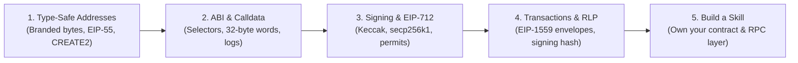

Each tutorial puts you inside a real Ethereum engineering problem, shows what breaks with untyped strings, and walks step by step from raw bytes to working TypeScript.

## Learning Path

<CardGroup cols={2}>
  <Card title="1. The $10M Parameter Swap" icon="shield" href="/tutorials/type-safe-addresses">
    Catch swapped addresses and hashes at compile time, trace EOA key derivation byte by byte, and predict CREATE2 addresses before deployment.
  </Card>
  <Card title="2. Reading Raw Calldata Like an EVM" icon="binary" href="/tutorials/abi-and-calldata">
    Dissect a 68-byte ERC-20 transfer by hand, visualize ABI head/tail layout for dynamic types, and decode contract event logs.
  </Card>
  <Card title="3. Building a Gasless Permit Relayer" icon="signature" href="/tutorials/signing-and-eip712">
    See why raw message signing invites cross-chain replay, then build an end-to-end EIP-712 signer and verifier.
  </Card>
  <Card title="4. Anatomy of an EIP-1559 Transaction" icon="paper-plane" href="/tutorials/transactions-and-rlp">
    Trace how RLP and EIP-2718 envelopes turn a JS object into signed wire bytes — and recover the sender offline.
  </Card>
  <Card title="5. Own Your Abstraction: Build a Skill" icon="wand-magic-sparkles" href="/tutorials/building-a-skill">
    Compose Voltaire primitives into a 50-line typed ERC-20 reader you own, customize, and hand to your AI coding assistant.
  </Card>
</CardGroup>

## Before You Start

Install `@tevm/voltaire` in a fresh directory (`bun add @tevm/voltaire` or `npm install @tevm/voltaire`). Every tutorial runs offline — no RPC key or testnet ETH needed until Tutorial 5.
