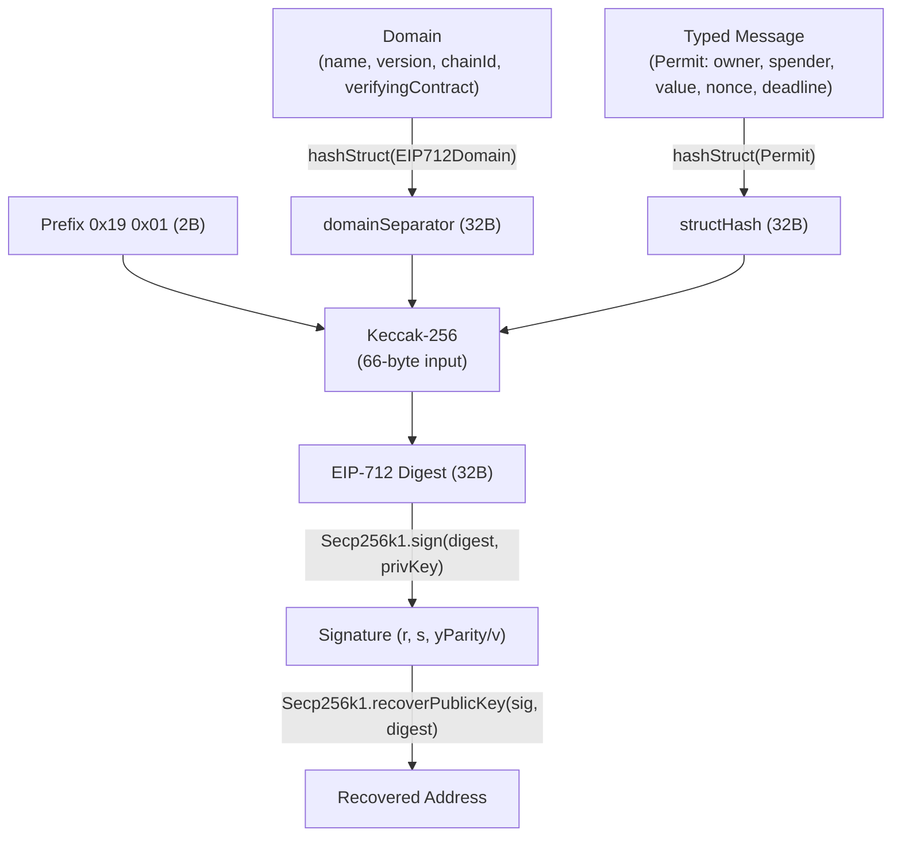

**Scenario:** Your app lets users approve USDC spending without paying gas. The user signs an off-chain "Permit" approval, sends the signature to your relayer over HTTP, and your relayer submits `permit(...)` on-chain.

## Spot the Replay Bug

Suppose you ask the user to sign a plain string with EIP-191 (`personal_sign`):

```text
Approve 0xSpender to spend 1000 USDC (nonce 0)
```

What goes wrong?

1. **Cross-chain replay:** An attacker takes the exact same signature and replays it on Arbitrum, Optimism, and Base where the user also holds USDC.
2. **Cross-contract replay:** If two tokens share the same message format, a signature meant for a testnet token works on mainnet.
3. **Opaque wallet UX:** Wallets show raw hex or unstructured text, so users cannot verify what they are signing.

## How EIP-712 Fixes All Three

EIP-712 binds every signature to a **domain separator** (name, version, `chainId`, `verifyingContract`) and a **typed struct hash**, joined under the `\x19\x01` prefix:



Why `0x19 0x01`? EIP-191 reserves `0x19` as a leading byte that can **never** be valid RLP (an RLP transaction list starts at `0xc0`–`0xff`, and typed EIP-2718 envelopes use `0x01`–`0x04`). That guarantees an EIP-712 digest can never collide with a valid Ethereum transaction!

<Warning>
Always check signature normalization (low-`s`, EIP-2). Because secp256k1 is symmetric across the x-axis, `(r, s, v)` and `(r, n - s, v ^ 1)` recover the same key unless the verifier rejects high-`s` values. Voltaire's `Secp256k1.sign` always produces canonical low-`s` signatures.
</Warning>

## Step-by-Step: Sign, Transmit, and Verify a Permit

<Steps>
  <Step title="Define the EIP-712 typed data payload">
    ```typescript
    import { Address, Hex } from '@tevm/voltaire';
    import { EIP712 } from '@tevm/voltaire/EIP712';
    import { Secp256k1 } from '@tevm/voltaire/Secp256k1';

    // Test signer key (Anvil account #0 — NEVER use in production)
    const ownerKey = Hex.toBytes(
      '0xac0974bec39a17e36ba4a6b4d238ff944bacb478cbed5efcae784d7bf4f2ff80',
    );
    const owner = Address.fromPrivateKey(ownerKey);

    const permitData = {
      domain: {
        name: 'USD Coin',
        version: '2',
        chainId: 1n,
        verifyingContract: Address('0xA0b86991c6218b36c1d19D4a2e9Eb0cE3606eB48'),
      },
      primaryType: 'Permit',
      types: {
        Permit: [
          { name: 'owner', type: 'address' },
          { name: 'spender', type: 'address' },
          { name: 'value', type: 'uint256' },
          { name: 'nonce', type: 'uint256' },
          { name: 'deadline', type: 'uint256' },
        ],
      },
      message: {
        owner,
        spender: Address('0x742d35Cc6634C0532925a3b844Bc9e7595f51e3e'),
        value: 1_000_000_000n, // 1,000 USDC
        nonce: 0n,
        deadline: 1_900_000_000n,
      },
    };
    ```
  </Step>

  <Step title="Compute the digest and sign on the client">
    ```typescript
    const digest = EIP712.hashTypedData(permitData);
    console.log('EIP-712 digest:', Hex.fromBytes(digest));

    const signature = EIP712.signTypedData(permitData, ownerKey);
    console.log('r:', Hex.fromBytes(signature.r));
    console.log('s:', Hex.fromBytes(signature.s));
    console.log('v:', signature.v);
    ```
  </Step>

  <Step title="Verify on the relayer before paying gas">
    Your relayer must verify the signature offline before submitting it on-chain so attackers cannot drain your relayer's ETH with invalid permits:

    ```typescript
    // Option A: High-level EIP-712 check
    const isValid = EIP712.verifyTypedData(signature, permitData, owner);
    console.log('Valid on Ethereum mainnet (chainId 1)?', isValid); // true

    // Option B: Recover signer address directly from (signature, digest)
    const recoveredPubKey = Secp256k1.recoverPublicKey(signature, digest);
    const recoveredAddr = Address.fromBytes(
      // Or use Address.fromPublicKey(x, y)
      Address.fromPublicKey(
        BigInt(Hex.fromBytes(recoveredPubKey.slice(0, 32))),
        BigInt(Hex.fromBytes(recoveredPubKey.slice(32, 64))),
      ),
    );
    console.log('Recovered signer:', Address.toChecksummed(recoveredAddr));
    console.log('Matches owner?  ', recoveredAddr.equals(owner)); // true
    ```
  </Step>

  <Step title="Prove cross-chain replay fails">
    Flip `chainId` from `1n` (Ethereum) to `42161n` (Arbitrum) and try verifying the exact same signature:

    ```typescript
    const arbitrumReplay = {
      ...permitData,
      domain: { ...permitData.domain, chainId: 42161n },
    };

    const replayValid = EIP712.verifyTypedData(signature, arbitrumReplay, owner);
    console.log('Valid on Arbitrum (chainId 42161)?', replayValid); // false!
    ```
  </Step>
</Steps>

<Accordion title="Check your understanding: Why does signature verification pass the signature FIRST in Secp256k1.recoverPublicKey(signature, digest)?">
Voltaire follows a consistent data-first convention: the object being inspected (`signature`) comes first, followed by the context it operates against (`digest`). When in doubt, TypeScript's branded types (`SignatureType` vs `HashType`) catch reversed arguments at compile time.
</Accordion>

## What You Built

- Bound an ERC-20 Permit signature to `chainId` and `verifyingContract` via EIP-712.
- Signed and recovered the signer offline using `EIP712` and `Secp256k1`.
- Proved that replaying the signature on another chain fails verification immediately.

**Next tutorial:** [Tutorial 4: Anatomy of an EIP-1559 Transaction](/tutorials/transactions-and-rlp)
