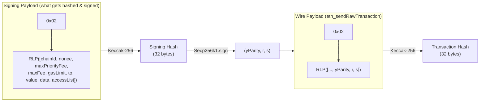

**Scenario:** You inspect a signed Ethereum transaction on the wire and notice something bizarre: **there is no `from` field anywhere in the bytes.** How does every node on Ethereum agree on who sent it?

## The Wire Format (EIP-2718 + EIP-1559)

An EIP-1559 transaction is a single type byte (`0x02`) concatenated with an RLP-encoded list of fields:



Nodes never trust a claimed `from` address. They strip `(yParity, r, s)`, recompute the signing hash over the remaining 9 fields, and run `ecrecover` to derive `from` cryptographically.

### How RLP Encodes Structure in Minimal Bytes

Recursive Length Prefix (RLP) encodes only two things: **byte strings** and **lists**. No types, no field names — order defines meaning:

| First byte | Meaning |
| --- | --- |
| `0x00` – `0x7f` | Single byte whose value is itself |
| `0x80` – `0xb7` | Byte string of length `byte - 0x80` (0–55 bytes); `0x80` = empty bytes / zero integer |
| `0xb8` – `0xbf` | Long byte string; next `byte - 0xb7` bytes hold length |
| `0xc0` – `0xf7` | List with payload length `byte - 0xc0` (0–55 bytes) |
| `0xf8` – `0xff` | Long list; next `byte - 0xf7` bytes hold payload length |

<Note>
Integers in RLP have **no leading zero bytes**, and the integer `0` encodes as the empty byte string `0x80` — NOT `0x00`. Getting `0` wrong breaks every transaction hash.
</Note>

## Step-by-Step: Build, Sign, Serialize, and Recover Offline

<Steps>
  <Step title="Construct an EIP-1559 transaction">
    ```typescript
    import { Address, Gwei, Hex, Transaction, Wei } from '@tevm/voltaire';
    import { Secp256k1 } from '@tevm/voltaire/Secp256k1';

    const senderKey = Hex.toBytes(
      '0xac0974bec39a17e36ba4a6b4d238ff944bacb478cbed5efcae784d7bf4f2ff80',
    );
    const expectedSender = Address.fromPrivateKey(senderKey);

    const unsignedTx: Transaction.EIP1559 = {
      type: Transaction.Type.EIP1559,
      chainId: 1n,
      nonce: 0n,
      maxPriorityFeePerGas: Gwei.toWei(Gwei(2n)),
      maxFeePerGas: Gwei.toWei(Gwei(30n)),
      gasLimit: 21_000n,
      to: Address('0xd8dA6BF26964aF9D7eEd9e03E53415D37aA96045'),
      value: Wei(100_000_000_000_000_000n), // 0.1 ETH
      data: new Uint8Array(),
      accessList: [],
      yParity: 0,
      r: new Uint8Array(32),
      s: new Uint8Array(32),
    };
    ```
  </Step>

  <Step title="Hash the unsigned payload and sign it">
    `Transaction.getSigningHash` encodes `0x02 || rlp([chainId, ..., accessList])` and returns the 32-byte Keccak-256 digest:

    ```typescript
    const signingHash = Transaction.getSigningHash(unsignedTx);
    const sig = Secp256k1.sign(signingHash, senderKey);

    const signedTx: Transaction.EIP1559 = {
      ...unsignedTx,
      yParity: sig.v === 27 || sig.v === 0 ? 0 : 1,
      r: sig.r,
      s: sig.s,
    };
    ```
  </Step>

  <Step title="Serialize to raw wire bytes and compute the tx hash">
    ```typescript
    const rawBytes = Transaction.serialize(signedTx);
    const txHash = Transaction.hash(signedTx);

    console.log('Envelope prefix:', '0x' + rawBytes[0].toString(16).padStart(2, '0'));
    // 0x02 (EIP-1559)
    console.log('Raw tx length:  ', rawBytes.length, 'bytes');
    console.log('Tx hash:        ', Hex.fromBytes(txHash));
    ```
  </Step>

  <Step title="Deserialize and recover the sender offline">
    Feed `rawBytes` back into `Transaction.deserialize` — exactly what an Ethereum execution client does when it receives `eth_sendRawTransaction`:

    ```typescript
    const decoded = Transaction.deserialize(rawBytes);
    const recoveredSender = Transaction.getSender(decoded);

    console.log('Recovered from:', Address.toChecksummed(recoveredSender));
    console.log('Matches signer?', Address.equals(recoveredSender, expectedSender));
    // true!
    ```
  </Step>
</Steps>

<Accordion title="Check your understanding: What happens if you bump maxPriorityFeePerGas to speed up a stuck transaction?">
You keep the exact same `nonce` and increase `maxPriorityFeePerGas` and `maxFeePerGas` (typically by at least 10% for mempool replacement). Because the fee fields changed, `getSigningHash` produces a new digest, you must re-sign, and `Transaction.hash` produces a new transaction hash. Voltaire's `Transaction.replaceWith(tx, { ... })` helps build replacement transactions cleanly.
</Accordion>

## What You Built

- Built an EIP-1559 transaction using branded `Address`, `Wei`, and `Gwei` values.
- Signed its EIP-2718 signing hash with `Secp256k1`.
- Serialized it to wire bytes (`0x02 || RLP(...)`), deserialized it, and cryptographically recovered `from`.

**Next tutorial:** [Tutorial 5: Own Your Abstraction: Build a Skill](/tutorials/building-a-skill)
