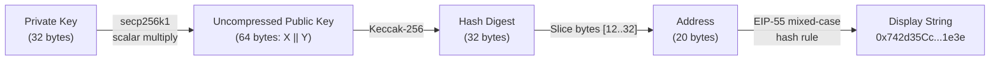

**Scenario:** You are shipping a treasury sweeper that moves USDC from hot wallets to cold storage and logs every receipt hash. Five minutes before deploy, someone refactors `recordSweep` and swaps two arguments.

## Spot the Bug Before Scrolling

```typescript
// Naive string-typed Ethereum code
type HexAddress = `0x${string}`;
type TxHash = `0x${string}`;

function recordSweep(vault: HexAddress, txHash: TxHash, feeWei: bigint) {
  db.insert({ vault, txHash, feeWei });
}

const vault: HexAddress = '0x742d35cc6634c0532925a3b844bc9e7595f51e3e';
const txHash: TxHash = '0x' + 'ab'.repeat(32);
const gasPriceGwei = 30n;

// Two silent bugs. TypeScript reports ZERO errors.
recordSweep(txHash, vault, gasPriceGwei);
```

Both `HexAddress` and `TxHash` collapse to `` `0x${string}` ``. TypeScript is structurally typed, so two aliases for the same template string are completely interchangeable. Worse, `gasPriceGwei` (30 gwei) was passed where wei was expected — off by a factor of `10^9`.

<Accordion title="Check your understanding: Why didn't TypeScript catch either bug?">
1. `type HexAddress = \`0x${string}\`` creates an alias, not a distinct type. Swapping `txHash` (32 bytes) and `vault` (20 bytes) satisfies the same string shape.
2. Plain `bigint` carries no unit. Nothing stops `Gwei` from flowing into a `Wei` parameter.
3. On top of that, `'0x742d...e3e' === '0x742d...E3e'` evaluates to `false` if one side is EIP-55 checksummed and the other is lowercase.
</Accordion>

## Under the Hood: What an Address Actually Is

An Ethereum address is **never** a string on the wire or in the EVM. It is **20 raw bytes** (160 bits). Strings are only for humans and JSON-RPC.



Voltaire stores `Address` as a **branded 20-byte `Uint8Array`**. At runtime it is a plain `Uint8Array` with zero wrapper allocation. At compile time, a phantom `unique symbol` brand makes `AddressType` incompatible with `HashType`, `BytecodeType`, and raw `Uint8Array`.

## Step-by-Step: Make the Bug Impossible to Compile

<Steps>
  <Step title="Lock down the function signature with branded types">
    Import the constructors from `@tevm/voltaire` and their types. Construct values once at the boundary (HTTP input, env var, RPC payload) — never re-validate inside business logic.

    ```typescript
    import { Address, Hash, Wei, Gwei } from '@tevm/voltaire';
    import type { AddressType } from '@tevm/voltaire/Address';
    import type { HashType } from '@tevm/voltaire/Hash';
    import type { WeiType } from '@tevm/voltaire/Denomination';

    function recordSweep(vault: AddressType, txHash: HashType, fee: WeiType) {
      console.log('Vault:', Address.toChecksummed(vault));
      console.log('Tx:   ', Hash.toHex(txHash));
      console.log('Fee:  ', fee.toString(), 'wei');
    }

    const vault = Address('0x742d35cc6634c0532925a3b844bc9e7595f51e3e');
    const txHash = Hash('0x' + 'ab'.repeat(32));
    const fee = Gwei.toWei(Gwei(30n)); // Explicit unit conversion!

    // Compiles cleanly:
    recordSweep(vault, txHash, fee);

    // Uncomment either line to see the compiler stop you dead:
    // recordSweep(txHash, vault, fee);      // Type error: HashType ≠ AddressType
    // recordSweep(vault, txHash, Gwei(30n)); // Type error: GweiType ≠ WeiType
    ```
  </Step>

  <Step title="Kill casing bugs forever">
    Because Voltaire stores 20 raw bytes, lowercase, uppercase, and EIP-55 checksummed inputs produce byte-identical values.

    ```typescript
    const lower = Address('0x742d35cc6634c0532925a3b844bc9e7595f51e3e');
    const mixed = Address('0x742d35Cc6634C0532925a3b844Bc9e7595f51e3e');

    console.log('Same bytes?', lower.equals(mixed));        // true
    console.log('Is Uint8Array?', lower instanceof Uint8Array); // true
    console.log('Byte length:', lower.length);              // 20
    console.log('Checksummed:', Address.toChecksummed(lower));
    // "0x742d35Cc6634C0532925a3b844Bc9e7595f51e3e"
    ```

    <Note>
    Need to reject a user-pasted address with a typo? Check `Address.isValidChecksum(input)` before calling `Address(input)`. EIP-55 encodes a 40-bit checksum in letter capitalization, catching 99.97% of single-character typos.
    </Note>
  </Step>

  <Step title="Derive an EOA address from a private key">
    Watch the diagram from earlier come alive in four lines:

    ```typescript
    import { Address, Hex } from '@tevm/voltaire';
    import { Keccak256 } from '@tevm/voltaire/Keccak256';
    import { Secp256k1 } from '@tevm/voltaire/Secp256k1';

    // Well-known test private key (NEVER use in production)
    const privateKey = Hex.toBytes(
      '0xac0974bec39a17e36ba4a6b4d238ff944bacb478cbed5efcae784d7bf4f2ff80',
    );

    // Manual derivation: privateKey -> 64-byte public key -> Keccak256 -> last 20 bytes
    const pubKey = Secp256k1.derivePublicKey(privateKey); // 64 bytes (x || y)
    const digest = Keccak256.hash(pubKey);                // 32 bytes
    const manual = Address.fromBytes(digest.slice(12));   // last 20 bytes

    // One-liner built into Address:
    const direct = Address.fromPrivateKey(privateKey);

    console.log('Manual:', Address.toChecksummed(manual));
    console.log('Direct:', Address.toChecksummed(direct));
    console.log('Match? ', manual.equals(direct)); // true
    // 0xf39Fd6e51aad88F6F4ce6aB8827279cffFb92266 (Anvil account #0!)
    ```
  </Step>

  <Step title="Predict a counterfactual contract address with CREATE2">
    Smart wallets (Safe, ERC-4337) receive funds **before** the contract is deployed. How? `CREATE2` computes the address deterministically from four inputs:

    ```mermaid
    flowchart LR
      P["0xff (1B)"] --> C["Concatenate\n85 bytes"]
      F["Deployer Address (20B)"] --> C
      S["Salt (32B)"] --> C
      I["Keccak256(initCode) (32B)"] --> C
      C -->|"Keccak-256 → slice [12..32]"| Out["Deterministic\nContract Address (20B)"]
    ```

    ```typescript
    import { Address, Bytecode, Bytes32 } from '@tevm/voltaire';

    const factory = Address('0x4e59b44847b379578588920cA78FbF26c0B4956C');
    const salt = Bytes32('0x' + '00'.repeat(31) + '01');
    const initCode = Bytecode('0x6080604052');

    const predicted = Address.calculateCreate2Address(factory, salt, initCode);
    console.log('Predicted vault:', Address.toChecksummed(predicted));
    ```
  </Step>
</Steps>

## What You Built

- Replaced untyped `0x${string}` and raw `bigint` parameters with `AddressType`, `HashType`, and `WeiType`.
- Verified why `Address` eliminates casing bugs by storing 20 raw bytes.
- Derived Anvil account #0 manually from secp256k1 + Keccak-256 and matched it with `Address.fromPrivateKey`.
- Computed a counterfactual `CREATE2` contract address offline.

**Next tutorial:** [Tutorial 2: Reading Raw Calldata Like an EVM](/tutorials/abi-and-calldata)
