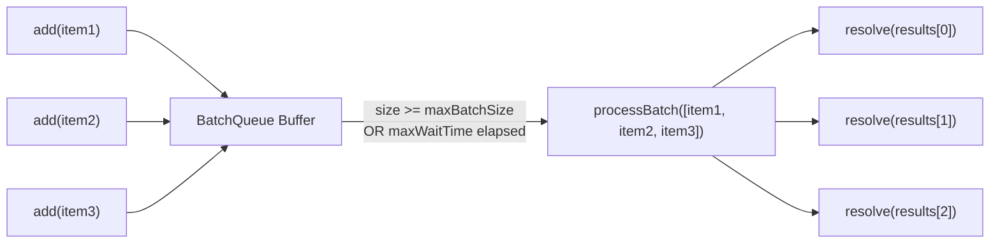

`@tevm/voltaire/utils` exports `BatchQueue` and `createBatchedFunction` to group concurrent calls into single batch executions, and `AsyncQueue` to bound concurrent in-flight promises.

Source: [batch.ts](https://github.com/evmts/voltaire/blob/main/packages/voltaire-ts/src/utils/batch.ts).



## `BatchQueue<T, R>`

`BatchQueue` accumulates items added via `.add(item)` and invokes `processBatch(items)` when either `queue.length >= maxBatchSize` or `maxWaitTime` milliseconds pass after the first queued item.

**Invariant:** `processBatch(items)` must return an array `R[]` with `results.length === items.length` in the same index order. If `processBatch` rejects, every pending promise in that batch rejects with the same error and `onError?.(error, items)` is called.

### Options (`BatchQueueOptions<T, R>`)

| Option | Type | Description |
| --- | --- | --- |
| `maxBatchSize` | `number` | Maximum items per `processBatch` invocation |
| `maxWaitTime` | `number` | Milliseconds to wait from the first queued item before flushing |
| `processBatch` | `(items: T[]) => Promise<R[]>` | Batch handler returning ordered results |
| `onError` | `(error: unknown, items: T[]) => void` | Optional error hook invoked before rejecting batch entries |

### Methods

| Method | Signature | Description |
| --- | --- | --- |
| `add` | `add(item: T): Promise<R>` | Enqueue an item and await its individual result |
| `flush` | `flush(): Promise<void>` | Flush up to `maxBatchSize` items immediately |
| `size` | `size(): number` | Number of buffered (unflushed) items |
| `clear` | `clear(): void` | Cancel timer and reject all buffered items with `Error('Queue cleared')` |
| `drain` | `drain(): Promise<void>` | Flush and wait until queue is empty and no batch is in flight |

### Example: JSON-RPC HTTP Batching

```typescript
import { BatchQueue } from '@tevm/voltaire/utils';

interface RpcCall {
  method: string;
  params: unknown[];
}

const rpcBatch = new BatchQueue<RpcCall, unknown>({
  maxBatchSize: 20,
  maxWaitTime: 10,
  processBatch: async (calls) => {
    const payload = calls.map((c, id) => ({ jsonrpc: '2.0', id, ...c }));
    const res = await fetch('https://eth.llamarpc.com', {
      method: 'POST',
      headers: { 'Content-Type': 'application/json' },
      body: JSON.stringify(payload),
    });
    const responses = (await res.json()) as Array<{ id: number; result?: unknown; error?: unknown }>;
    const byId = new Map(responses.map((r) => [r.id, r]));
    return calls.map((_, id) => {
      const entry = byId.get(id);
      if (entry?.error) throw entry.error;
      return entry?.result;
    });
  },
});

const [blockHex, chainIdHex] = await Promise.all([
  rpcBatch.add({ method: 'eth_blockNumber', params: [] }),
  rpcBatch.add({ method: 'eth_chainId', params: [] }),
]);
```

## `createBatchedFunction`

Convenience wrapper around `BatchQueue` returning a single-item function `(item: T) => Promise<R>`:

```typescript
import { createBatchedFunction } from '@tevm/voltaire/utils';

const getBalances = createBatchedFunction<`0x${string}`, string>(
  async (addresses) => fetchBalancesViaMulticall(addresses),
  50, // maxBatchSize
  15, // maxWaitTime (ms)
);

const [b1, b2] = await Promise.all([
  getBalances('0x742d35Cc6634C0532925a3b844Bc9e7595f0bEb0'),
  getBalances('0xd8dA6BF26964aF9D7eEd9e03E53415D37aA96045'),
]);
```

## `AsyncQueue<T, R>`

`AsyncQueue` processes items individually while keeping at most `concurrency` promises executing at once. Unlike `BatchQueue`, each item runs through `processFn(item)` independently, so one item failing does not reject other items in flight.

```typescript
import { Rpc } from '@tevm/voltaire/jsonrpc';
import { AsyncQueue } from '@tevm/voltaire/utils';

const blockFetcher = new AsyncQueue<bigint, unknown>(
  (blockNum) =>
    provider.request(Rpc.Eth.GetBlockByNumberRequest(`0x${blockNum.toString(16)}`, false)),
  { concurrency: 5 },
);

const blocks = await Promise.all(
  Array.from({ length: 50 }, (_, i) => blockFetcher.add(19_000_000n + BigInt(i))),
);
```

| Method | Signature | Description |
| --- | --- | --- |
| `add` | `add(item: T): Promise<R>` | Enqueue an item for execution |
| `size` | `size(): number` | Waiting items not yet started |
| `activeCount` | `activeCount(): number` | Currently executing items (`<= concurrency`) |
| `drain` | `drain(): Promise<void>` | Resolves when both `size() === 0` and `activeCount() === 0` |

## Related

- [Rate Limiting](/utils/rate-limit) — Enforcing requests-per-interval caps alongside concurrency bounds
- [Batched Provider Skill](/skills/batched-provider) — Copyable EIP-1193 provider with JSON-RPC batching
- [Multicall Skill](/skills/multicall) — Batching contract reads on-chain via Multicall3
