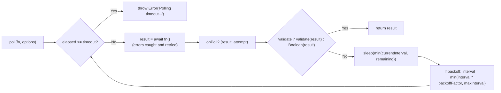

`@tevm/voltaire/utils` exports four polling functions for waiting on asynchronous chain state: `poll`, `pollUntil`, `pollForReceipt`, and `pollWithBackoff`.

Source: [poll.ts](https://github.com/evmts/voltaire/blob/main/packages/voltaire-ts/src/utils/poll.ts).



## Signatures

```typescript
import {
  poll,
  pollForReceipt,
  pollUntil,
  pollWithBackoff,
  type PollOptions,
} from '@tevm/voltaire/utils';

function poll<T>(fn: () => Promise<T>, options?: PollOptions<T>): Promise<T>;

function pollUntil<T>(
  fn: () => Promise<T>,
  predicate: (result: T) => boolean,
  options?: Omit<PollOptions<T>, 'validate'>,
): Promise<T>;

function pollForReceipt<TReceipt>(
  txHash: string,
  getReceipt: (hash: string) => Promise<TReceipt | null>,
  options?: Omit<PollOptions<TReceipt | null>, 'validate'>,
): Promise<TReceipt>;

function pollWithBackoff<T>(fn: () => Promise<T>, options?: PollOptions<T>): Promise<T>;
```

## Options (`PollOptions<T>`)

| Option | Type | Default | Description |
| --- | --- | --- | --- |
| `interval` | `number` | `1000` | Delay between polls (ms) |
| `timeout` | `number` | `60000` | Maximum total elapsed time before throwing `Error` (ms) |
| `backoff` | `boolean` | `false` | Multiply `interval` by `backoffFactor` after each poll (`true` in `pollWithBackoff`) |
| `backoffFactor` | `number` | `1.5` | Interval growth multiplier when `backoff` is `true` |
| `maxInterval` | `number` | `10000` | Maximum interval cap under backoff (ms) |
| `validate` | `(result: T) => boolean` | `Boolean(result)` | Predicate that returns `true` when polling should resolve |
| `onPoll` | `(result: T, attempt: number) => void` | `undefined` | Invoked after every non-throwing call (`attempt` is 0-indexed) |

<Note>
Exceptions thrown by `fn()` during a poll cycle are swallowed so transient RPC failures do not abort the poll loop. If `fn()` never succeeds before `timeout`, `poll` throws `Error('Polling timeout after <ms>ms')`.
</Note>

## Usage

### Wait for a Transaction Receipt (`pollForReceipt`)

```typescript
import { Rpc } from '@tevm/voltaire/jsonrpc';
import { pollForReceipt } from '@tevm/voltaire/utils';

interface TxReceipt {
  status: string;
  blockNumber: string;
  gasUsed: string;
}

const receipt = await pollForReceipt<TxReceipt>(
  txHash,
  (hash) =>
    provider.request(Rpc.Eth.GetTransactionReceiptRequest(hash)) as Promise<TxReceipt | null>,
  {
    interval: 2000,
    timeout: 120_000,
    onPoll: (r, attempt) => {
      if (!r) console.log(`Waiting for confirmation (attempt ${attempt + 1})...`);
    },
  },
);

if (receipt.status !== '0x1') {
  throw new Error(`Transaction ${txHash} reverted`);
}
```

### Wait for a Block Height or Deployed Code (`pollUntil`)

```typescript
import { Rpc } from '@tevm/voltaire/jsonrpc';
import { pollUntil } from '@tevm/voltaire/utils';

const targetBlock = 19_000_500n;

const reachedBlock = await pollUntil(
  async () => BigInt((await provider.request(Rpc.Eth.BlockNumberRequest())) as string),
  (block) => block >= targetBlock,
  { interval: 4000, timeout: 300_000 },
);
```

### Poll with Exponential Backoff (`pollWithBackoff`)

Start fast for quick L2 confirmations and back off smoothly on congested networks:

```typescript
const receipt = await pollWithBackoff(
  () => provider.request(Rpc.Eth.GetTransactionReceiptRequest(txHash)),
  {
    interval: 250,
    backoffFactor: 2,
    maxInterval: 5000,
    timeout: 60_000,
    validate: (r) => r !== null,
  },
);
```

## Related

- [Contract Write Methods](/contract/write) — Submitting transactions and awaiting receipts
- [Contract Events](/contract/events) — Polling logs with `EventStream.watch()`
- [Timeout Utilities](/utils/timeout) — Hard deadlines and `AbortSignal` cancellation
