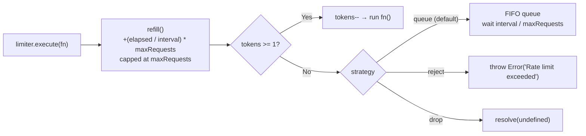

`@tevm/voltaire/utils` provides a token-bucket `RateLimiter` for async RPC quotas plus `throttle` and `debounce` for high-frequency event handlers.

Source: [rateLimit.ts](https://github.com/evmts/voltaire/blob/main/packages/voltaire-ts/src/utils/rateLimit.ts).



## `RateLimiter`

### Constructor & Options (`RateLimiterOptions`)

```typescript
import { RateLimiter, type RateLimiterOptions } from '@tevm/voltaire/utils';

const limiter = new RateLimiter({
  maxRequests: 10,
  interval: 1000,
  strategy: 'queue', // 'queue' | 'reject' | 'drop' (default: 'queue')
});
```

| Option | Type | Default | Description |
| --- | --- | --- | --- |
| `maxRequests` | `number` | required | Bucket capacity and tokens refilled per `interval` |
| `interval` | `number` | required | Refill period in milliseconds |
| `strategy` | `'queue' \| 'reject' \| 'drop'` | `'queue'` | Behavior when `tokens < 1` |

### Methods

| Method | Signature | Behavior |
| --- | --- | --- |
| `execute` | `execute<T>(fn: () => Promise<T>): Promise<T>` | Consumes 1 token or applies overflow `strategy` |
| `wrap` | `wrap<TArgs, TReturn>(fn: (...args: TArgs) => Promise<TReturn>)` | Returns a rate-limited version of `fn` |
| `getTokens` | `getTokens(): number` | Refills based on elapsed time and returns available tokens |
| `getQueueLength` | `getQueueLength(): number` | Returns number of waiting queued calls |
| `clearQueue` | `clearQueue(): void` | Empties queued items (does not reject already-queued promises) |

### Example

```typescript
import { Rpc } from '@tevm/voltaire/jsonrpc';
import { RateLimiter } from '@tevm/voltaire/utils';

const limiter = new RateLimiter({
  maxRequests: 25,
  interval: 1000,
  strategy: 'queue',
});

const getBalance = limiter.wrap(
  (addr: `0x${string}`) =>
    provider.request(Rpc.Eth.GetBalanceRequest(addr, 'latest')) as Promise<string>,
);

const balances = await Promise.all(addresses.map((addr) => getBalance(addr)));
```

<Note>
When `strategy: 'drop'` is configured and the bucket is empty, `execute()` resolves to `undefined` cast to `T`. Check for `undefined` before dereferencing results under `'drop'`.
</Note>

## `throttle`

Executes `fn` immediately on the first call, then returns the cached `lastResult` without re-invoking `fn` until `wait` milliseconds have elapsed.

```typescript
import { throttle } from '@tevm/voltaire/utils';

const refreshBlock = throttle(
  () => provider.request({ method: 'eth_blockNumber', params: [] }),
  1000,
);

const p1 = refreshBlock(); // Executes immediately
const p2 = refreshBlock(); // Within 1000ms: returns p1 without issuing a second request
```

## `debounce`

Delays execution until `wait` milliseconds pass without another call. Exposes `.cancel()` to clear any pending timer.

```typescript
import { debounce } from '@tevm/voltaire/utils';

const lookupEns = debounce((name: string) => {
  void resolveEnsName(name);
}, 300);

lookupEns('vit');
lookupEns('vitalik.eth'); // Cancels previous timer; executes after 300ms

// Cancel on component unmount
lookupEns.cancel();
```

## Related

- [Rate Limiting Guide](/guides/rate-limiting) — Sizing budgets for Infura, Alchemy, and QuickNode compute units
- [Batching Utilities](/utils/batch) — Reducing total RPC count via `BatchQueue`
- [Retry Utilities](/utils/retry) — Handling upstream `429` / `-32005` responses
