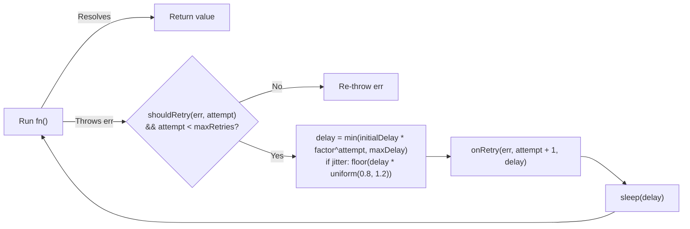

`retryWithBackoff` and `withRetry` re-execute rejected async operations using bounded exponential backoff with optional jitter.

Source: [retryWithBackoff.ts](https://github.com/evmts/voltaire/blob/main/packages/voltaire-ts/src/utils/retryWithBackoff.ts).



## Signatures

```typescript
import { retryWithBackoff, withRetry, type RetryOptions } from '@tevm/voltaire/utils';

function retryWithBackoff<T>(
  fn: () => Promise<T>,
  options?: RetryOptions,
): Promise<T>;

function withRetry<TArgs extends unknown[], TReturn>(
  fn: (...args: TArgs) => Promise<TReturn>,
  options?: RetryOptions,
): (...args: TArgs) => Promise<TReturn>;
```

## Options (`RetryOptions`)

| Option | Type | Default | Description |
| --- | --- | --- | --- |
| `maxRetries` | `number` | `3` | Retry attempts after the initial call (total executions = `maxRetries + 1`) |
| `initialDelay` | `number` | `1000` | Base delay before retry 1 (ms) |
| `factor` | `number` | `2` | Exponential multiplier per attempt |
| `maxDelay` | `number` | `30000` | Upper cap on computed delay before jitter (ms) |
| `jitter` | `boolean` | `true` | Multiplies delay by a uniform random value in `[0.8, 1.2)` to avoid thundering herds |
| `shouldRetry` | `(error: unknown, attempt: number) => boolean` | always `true` | Predicate controlling whether to retry (`attempt` is 0-indexed) |
| `onRetry` | `(error: unknown, attempt: number, nextDelay: number) => void` | `undefined` | Hook called before sleeping (`attempt` is 1-indexed) |

## Usage

### Selective RPC Retry

Skip retries on permanent JSON-RPC errors (invalid params, unsupported method, user rejection, execution revert):

```typescript
import { Rpc } from '@tevm/voltaire/jsonrpc';
import { EIP1193ErrorCode, JsonRpcErrorCode } from '@tevm/voltaire/provider';
import { retryWithBackoff } from '@tevm/voltaire/utils';

const NON_RETRYABLE = new Set<number>([
  JsonRpcErrorCode.InvalidParams,
  JsonRpcErrorCode.MethodNotFound,
  EIP1193ErrorCode.UserRejectedRequest,
  3, // Execution reverted
]);

const blockHex = await retryWithBackoff(
  () => provider.request(Rpc.Eth.BlockNumberRequest()) as Promise<string>,
  {
    maxRetries: 4,
    initialDelay: 500,
    factor: 2,
    maxDelay: 10_000,
    jitter: true,
    shouldRetry: (err) => {
      const code = (err as { code?: number })?.code;
      return code === undefined || !NON_RETRYABLE.has(code);
    },
    onRetry: (err, retryNumber, nextDelay) => {
      console.warn(`Retry #${retryNumber} in ${nextDelay}ms:`, err);
    },
  },
);
```

### Reusable Function Wrapper (`withRetry`)

```typescript
import { Rpc } from '@tevm/voltaire/jsonrpc';
import { withRetry } from '@tevm/voltaire/utils';

const getBalance = withRetry(
  (address: `0x${string}`) =>
    provider.request(Rpc.Eth.GetBalanceRequest(address, 'latest')) as Promise<string>,
  { maxRetries: 3, initialDelay: 300 },
);

const balance = await getBalance('0x742d35Cc6634C0532925a3b844Bc9e7595f0bEb0');
```

## Related

- [Timeout Utilities](/utils/timeout) — Per-attempt deadlines via `withTimeout` / `executeWithTimeout`
- [Rate Limiting](/utils/rate-limit) — Preventing rate-limit errors upstream
- [Error Handling](/jsonrpc-provider/error-handling) — JSON-RPC and EIP-1193 error codes
