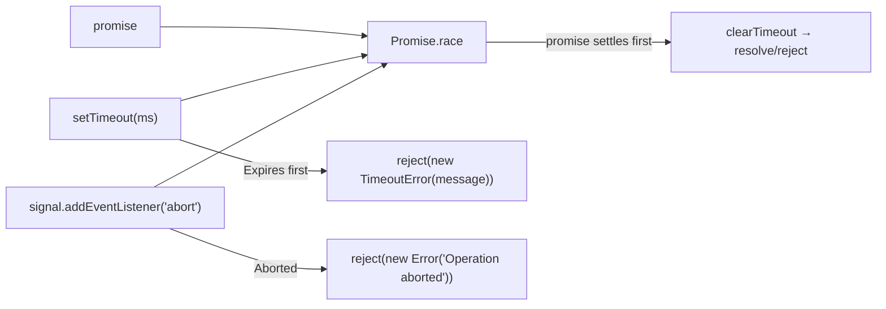

`@tevm/voltaire/utils` provides timeout and cancellation primitives so stalled RPC sockets or hung promises fail predictably with `TimeoutError`.

Source: [timeout.ts](https://github.com/evmts/voltaire/blob/main/packages/voltaire-ts/src/utils/timeout.ts).



## Exports & Signatures

```typescript
import {
  createDeferred,
  executeWithTimeout,
  sleep,
  TimeoutError,
  withTimeout,
  wrapWithTimeout,
  type TimeoutOptions,
} from '@tevm/voltaire/utils';

class TimeoutError extends Error {
  constructor(message?: string); // default: "Operation timed out", name: "TimeoutError"
}

function withTimeout<T>(promise: Promise<T>, options: TimeoutOptions): Promise<T>;

function wrapWithTimeout<TArgs extends unknown[], TReturn>(
  fn: (...args: TArgs) => Promise<TReturn>,
  ms: number,
  message?: string,
): (...args: TArgs) => Promise<TReturn>;

function executeWithTimeout<T>(
  fn: () => Promise<T>,
  timeoutMs: number,
  maxRetries?: number, // default: 0
): Promise<T>;

function sleep(ms: number, signal?: AbortSignal): Promise<void>;

function createDeferred<T>(): {
  promise: Promise<T>;
  resolve: (value: T) => void;
  reject: (error: unknown) => void;
};
```

### `TimeoutOptions`

| Field | Type | Default | Description |
| --- | --- | --- | --- |
| `ms` | `number` | required | Timeout duration in milliseconds |
| `message` | `string` | `'Operation timed out'` | Error message passed to `TimeoutError` |
| `signal` | `AbortSignal` | `undefined` | External cancellation signal (rejects with `Error('Operation aborted')`) |

## Usage

### Racing a Request Against a Deadline (`withTimeout`)

```typescript
import { Rpc } from '@tevm/voltaire/jsonrpc';
import { TimeoutError, withTimeout } from '@tevm/voltaire/utils';

const controller = new AbortController();

try {
  const block = await withTimeout(
    provider.request(Rpc.Eth.GetBlockByNumberRequest('latest', false)),
    {
      ms: 5000,
      message: 'eth_getBlockByNumber timed out after 5s',
      signal: controller.signal,
    },
  );
} catch (err) {
  if (err instanceof TimeoutError) {
    console.error('RPC deadline exceeded:', err.message);
  } else {
    throw err;
  }
}
```

### Wrapping Reusable Functions (`wrapWithTimeout`)

```typescript
import { Rpc } from '@tevm/voltaire/jsonrpc';
import { wrapWithTimeout } from '@tevm/voltaire/utils';

const fetchBlock = wrapWithTimeout(
  (tag: string) => provider.request(Rpc.Eth.GetBlockByNumberRequest(tag, false)),
  5000,
  'Block fetch timed out',
);
```

### Fresh Timeout Per Attempt (`executeWithTimeout`)

`executeWithTimeout(fn, timeoutMs, maxRetries)` gives each attempt a fresh deadline, sleeps `100` ms between retries, and retries **only** when `error instanceof TimeoutError`. Non-timeout errors re-throw immediately.

```typescript
import { Rpc } from '@tevm/voltaire/jsonrpc';
import { executeWithTimeout } from '@tevm/voltaire/utils';

const blockHex = await executeWithTimeout(
  () => provider.request(Rpc.Eth.BlockNumberRequest()) as Promise<string>,
  3000, // 3s per attempt
  2,    // up to 2 retries on TimeoutError
);
```

### Cancellable Delay (`sleep`) and Manual Promises (`createDeferred`)

```typescript
import { createDeferred, sleep } from '@tevm/voltaire/utils';

// Cancellable sleep
const ac = new AbortController();
setTimeout(() => ac.abort(), 500);
await sleep(5000, ac.signal).catch(() => console.log('Sleep aborted'));

// Bridge callback event into an awaitable promise
const deferred = createDeferred<string>();
const onChain = (chainId: string) => {
  provider.removeListener('chainChanged', onChain);
  deferred.resolve(chainId);
};
provider.on('chainChanged', onChain);
const nextChain = await withTimeout(deferred.promise, { ms: 30_000 });
```

## Related

- [Retry Utilities](/utils/retry) — Exponential backoff across arbitrary retryable errors
- [Polling Utilities](/utils/polling) — Repeated checks with an overall timeout
- [Provider Fallback Guide](/guides/provider-fallback) — Combining per-endpoint timeouts with failover
