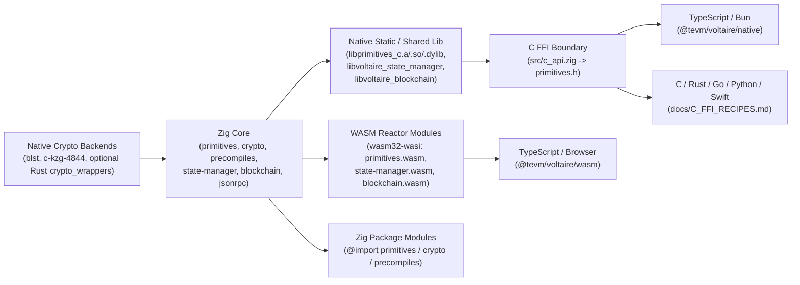

# Voltaire (Zig)

Core Ethereum primitives, cryptography, precompiles, and execution components written in Zig 0.17.

Voltaire's Zig core (published to npm as `@tevm/zig`) serves both as a standalone Zig package and as the native/WASM/C ABI foundation for `@tevm/voltaire` and external C FFI consumers (see [C FFI Recipes](../../docs/C_FFI_RECIPES.md)). Every type has an explicit byte layout, explicit allocator ownership, and compile-time validation where inputs are static.

## Architecture



## Exported Zig Modules

`build.zig` exports seven modules (plus `*_wasm` variants for WASM builds) from the repository root (`build.zig.zon` package `.voltaire`, version `0.5.0`, `minimum_zig_version = "0.17.1"`):

| Module | Root Source | Contents |
| :--- | :--- | :--- |
| `primitives` | `packages/voltaire-zig/src/primitives/root.zig` | `Address`, `Hash`, `Bytes32`, `Hex`, `Rlp`, `AbiEncoding`, `Transaction`, `Bytecode`, `Opcode`, `Hardfork`, `Trie`, `Ssz`, `Uint`, `Denomination`, EIP-4844/7702 types |
| `crypto` | `packages/voltaire-zig/src/crypto/root.zig` | `Keccak256`, `Hash`, `HashUtils`, `Keccak256_Accel`, `keccak_asm`, `Crypto`, `secp256k1`, `bls12_381`, `bn254`, `bn254_arkworks`, `c_kzg`, `ModExp`, `Blake2`, `Ripemd160`, `Eip712`, `bip39`, `p256`, `ed25519`, `aes_gcm` |
| `precompiles` | `packages/voltaire-zig/src/evm/precompiles/root.zig` | Hardfork-gated EVM precompiles `0x01`–`0x11` (Frontier through Prague) and `0x0100` (`P256VERIFY`, Osaka) |
| `state-manager` | `packages/voltaire-zig/src/state-manager/root.zig` | Account, storage, snapshot/revert, and fork state backend |
| `blockchain` | `packages/voltaire-zig/src/blockchain/root.zig` | Block store, canonical chain tracking, and reorg handling |
| `jsonrpc` | `packages/voltaire-zig/src/jsonrpc/root.zig` | Self-contained Ethereum JSON-RPC request/response types |
| `c_kzg` | `packages/voltaire-zig/lib/c-kzg-4844/bindings/zig/root.zig` | EIP-4844 KZG bindings over `c-kzg-4844` and `blst` |

## Prerequisites

- Zig `0.17.1` or newer (default builds require **zero Rust / Cargo** — pure-Zig BN254/Keccak plus C `blst` and `c-kzg-4844` compiled directly by Zig)
- Optional: Rust / `cargo` only if opting into `-Dwith-rust=true` (`arkworks` BN254 + `keccak-asm`)

## Installation (`zig fetch --save`)

Fetch Voltaire directly into your project's `build.zig.zon` with one command:

```bash
zig fetch --save https://github.com/evmts/voltaire/archive/refs/heads/main.tar.gz
```

This adds a `.voltaire` entry to `build.zig.zon` with its verified package hash:

```zig
.dependencies = .{
    .voltaire = .{
        .url = "https://github.com/evmts/voltaire/archive/refs/heads/main.tar.gz",
        .hash = "...", // populated by `zig fetch --save`
    },
},
```

Wire the modules in `build.zig`:

```zig
const std = @import("std");

pub fn build(b: *std.Build) void {
    const target = b.standardTargetOptions(.{});
    const optimize = b.standardOptimizeOption(.{});

    const voltaire = b.dependency("voltaire", .{
        .target = target,
        .optimize = optimize,
    });

    const exe = b.addExecutable(.{
        .name = "eth-tool",
        .root_module = b.createModule(.{
            .root_source_file = b.path("src/main.zig"),
            .target = target,
            .optimize = optimize,
        }),
    });

    exe.root_module.addImport("primitives", voltaire.module("primitives"));
    exe.root_module.addImport("crypto", voltaire.module("crypto"));
    exe.root_module.addImport("precompiles", voltaire.module("precompiles"));
    b.installArtifact(exe);
}
```

## Quick Start

Fixed-size values return by value with zero heap allocation. Functions that produce variable-length slices take an explicit `std.mem.Allocator`; the caller frees the returned slice.

```zig
const std = @import("std");
const primitives = @import("primitives");
const crypto = @import("crypto");

const Address = primitives.Address;
const Hash = primitives.Hash;
const Rlp = primitives.Rlp;

pub fn main() !void {
    var gpa = std.heap.GeneralPurposeAllocator(.{}){};
    defer _ = gpa.deinit();
    const allocator = gpa.allocator();

    // Compile-time validated 20-byte address (zero runtime cost)
    const deployer = comptime Address.addressFromHex("0x742d35cc6634c0532925a3b844bc9e7595f51e3e".*);
    const checksum = Address.toChecksummed(deployer); // [42]u8 on stack

    // Stack-only Keccak-256 digest (32 bytes)
    const digest = Hash.keccak256("transfer(address,uint256)");
    const selector = crypto.Hash.selectorFromSignature("transfer(address,uint256)"); // [4]u8

    // Deterministic CREATE2 address with pre-hashed init code (zero allocation)
    const salt = [_]u8{0} ** 31 ++ [_]u8{0x01};
    const init_code_hash = Hash.keccak256(&[_]u8{ 0x60, 0x80, 0x60, 0x40, 0x52 });
    const deployed = Address.getCreate2Address(deployer, salt, init_code_hash);

    // Variable-length RLP encoding (caller owns returned buffer)
    const items = [_][]const u8{ "cat", "dog" };
    const encoded = try Rlp.encode(allocator, items[0..]);
    defer allocator.free(encoded);

    std.debug.print("Deployer: {s}\n", .{&checksum});
    std.debug.print("CREATE2:  {s}\n", .{&Address.toChecksummed(deployed)});
    std.debug.print("Selector: 0x{x:0>2}{x:0>2}{x:0>2}{x:0>2}\n", .{
        selector[0], selector[1], selector[2], selector[3],
    });
    std.debug.print("Digest:   {s}\n", .{&crypto.Hash.toHex(digest)});
    std.debug.print("RLP len:  {d} bytes\n", .{encoded.len});
}
```

## Build & Test Commands

Run from the repository root:

```bash
# Run all Zig test suites (zero Rust/Cargo required by default)
zig build test

# Run all Zig test suites with optional Rust arkworks + keccak-asm wrappers
zig build test -Dwith-rust=true

# Run state-manager tests only
zig build test-state-manager

# Run runnable Zig examples
zig build example-address
zig build example-keccak256
zig build example-hex
zig build example-rlp
zig build example-abi
zig build example-transaction
zig build example-secp256k1
zig build example-eip712
zig build example-eip4844
zig build example-eip7702
zig build example-bls

# Build WASM reactor binaries (ReleaseSmall -> wasm/primitives.wasm, etc.)
zig build build-ts-wasm

# Build C API static/shared libraries and primitives.h
# (requires the libwally-core submodule: git submodule update --init packages/voltaire-zig/lib/libwally-core)
zig build -Dwith-c-api=true

# Regenerate C header from src/c_api.zig
zig build generate-header

# Run zBench benchmarks
zig build bench -Dwith-benches=true
```

## Allocator & Safety Invariants

1. **Zero-allocation fixed types**: `Address` (`struct { bytes: [20]u8 }`), `Hash` (`[32]u8`), `Selector` (`[4]u8`), `Address.toHex`/`toChecksummed` (`[42]u8`), `crypto.Hash.toHex` (`[66]u8`), `Hex.hexToBytesFixed`, `Hex.bytesToHexFixed`, and `Address.getCreate2Address` operate entirely on the stack.
2. **Explicit ownership**: Any function returning a slice (`[]u8`, `[]AbiValue`, `Rlp.Decoded`) takes an explicit `std.mem.Allocator` and transfers ownership to the caller.
3. **Zig 0.17 unmanaged collections & explicit `std.Io`**: Internal code uses unmanaged `std.ArrayList(T){}` and passes `allocator` to `append`/`deinit`/`toOwnedSlice`; clock, randomness, and file APIs accept an explicit `io: std.Io`.
4. **Audit boundaries**: Functions prefixed with `unaudited_` in `crypto.Crypto` and `crypto.secp256k1` are custom recovery/signing implementations that have not undergone an independent security audit. Production systems requiring audited native curves should use `blst` (BLS12-381), `c-kzg-4844` (KZG), `bn254_arkworks` (BN254), or `libsecp256k1`.

## Documentation

- [Documentation Index](./docs/index.mdx)
- [Getting Started](./docs/getting-started.mdx)
- [Tutorial: Build Your First Ethereum CLI Tool in Zig](./docs/tutorials/first-ethereum-tool.mdx)
- [Architecture](./docs/dev/architecture.mdx)
- [Zig 0.15 Patterns](./docs/dev/zig-patterns.mdx)

## License

MIT
