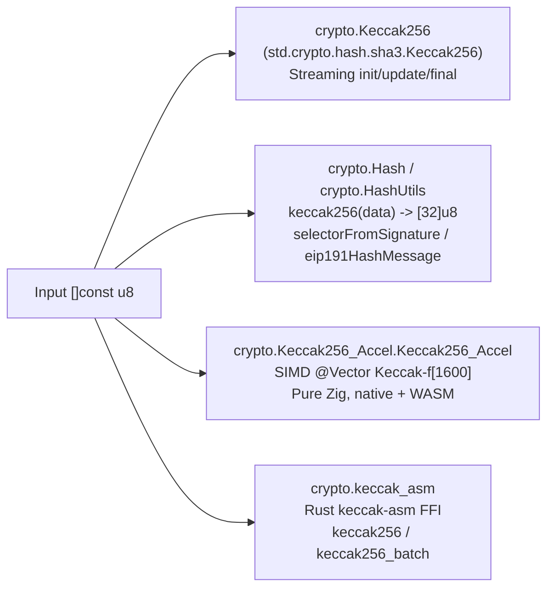

Keccak-256 is a sponge-construction cryptographic hash with 1088-bit rate (136 bytes), 512-bit capacity, and 256-bit (32-byte) digest. Ethereum uses original Keccak-256 (`0x01` domain padding), **not** NIST FIPS 202 SHA3-256 (`0x06` domain padding).

<Warning>
Never substitute `std.crypto.hash.sha3.Sha3_256` for Ethereum digests. For `""`, Keccak-256 produces `0xc5d246...85a470`, whereas NIST SHA3-256 produces `0xa7ffc6...4597f8`.
</Warning>

## Backend Selection

Voltaire exports four Keccak-256 entry points from `crypto` (plus `primitives.Hash.keccak256`):



| Entry Point | Source | Streaming | Allocates | Targets |
| :--- | :--- | :--- | :--- | :--- |
| `crypto.Keccak256` | `std.crypto.hash.sha3.Keccak256` | Yes (`init`/`update`/`final`) | No | Native + WASM |
| `crypto.Hash.keccak256` / `primitives.Hash.keccak256` | `src/crypto/hash_utils.zig` / `src/primitives/Hash/Hash.zig` | No (one-shot) | No | Native + WASM |
| `crypto.Keccak256_Accel.Keccak256_Accel.hash` | `src/crypto/keccak256_accel.zig` | No (one-shot) | No | Native + WASM (AVX2/SIMD) |
| `crypto.keccak_asm.keccak256` | `src/crypto/keccak_asm.zig` -> `keccak_wrapper.rs` | No (one-shot + batch) | No | Native + WASM (via `crypto_wrappers`) |

## One-Shot & Streaming Usage

```zig
const std = @import("std");
const crypto = @import("crypto");
const HashUtils = crypto.HashUtils;

pub fn main() !void {
    // 1. One-shot helper (returns [32]u8 on stack)
    const digest = HashUtils.keccak256("hello");
    const hex: [66]u8 = HashUtils.toHex(digest);
    // 0x1c8aff950685c2ed4bc3174f3472287b56d9517b9c948127319a09a7a36deac8

    // 2. Streaming Keccak-256 (zero allocation for multi-chunk input)
    var hasher = crypto.Keccak256.init(.{});
    hasher.update("hel");
    hasher.update("lo");
    var streamed: [32]u8 = undefined;
    hasher.final(&streamed);
    std.debug.assert(HashUtils.equal(digest, streamed));

    // 3. SIMD-accelerated pure Zig permutation
    var accel_out: [32]u8 = undefined;
    crypto.Keccak256_Accel.Keccak256_Accel.hash("hello", &accel_out);
    std.debug.assert(HashUtils.equal(digest, accel_out));

    // 4. Rust keccak-asm FFI backend
    var asm_out: [32]u8 = undefined;
    try crypto.keccak_asm.keccak256("hello", &asm_out);
    std.debug.assert(HashUtils.equal(digest, asm_out));

    std.debug.print("Keccak-256(\"hello\") = {s}\n", .{&hex});
}
```

## Ethereum Helpers (`crypto.Hash` / `crypto.HashUtils`)

| Function | Signature | Allocates | Description |
| :--- | :--- | :--- | :--- |
| `keccak256` | `fn (data: []const u8) [32]u8` | No | One-shot Keccak-256 |
| `keccak256Empty` | `fn () [32]u8` | No | Returns `EMPTY_KECCAK256` constant |
| `selectorFromSignature` | `fn (sig: []const u8) [4]u8` | No | First 4 bytes of `keccak256(sig)` |
| `eip191HashMessage` | `fn (message: []const u8, allocator: Allocator) !Hash` | Temporary (freed internally) | `keccak256("\x19Ethereum Signed Message:\n" ++ len ++ message)` |
| `toHex` / `toHexUpper` | `fn (hash: Hash) [66]u8` | No | Stack-allocated `"0x..."` |
| `fromHexComptime` | `fn (comptime hex: []const u8) Hash` | No | Compile-time validated 66-char `"0x..."` |
| `equal` / `compare` / `isZero` | `fn (...) bool\|...` | No | Comparison helpers |
| `xor` / `bitAnd` / `bitOr` / `bitNot` | `fn (...) Hash` | No | 256-bit bitwise operations |

## Known Test Vectors

| Input | Keccak-256 Digest |
| :--- | :--- |
| `""` (empty) | `0xc5d2460186f7233c927e7db2dcc703c0e500b653ca82273b7bfad8045d85a470` |
| `"abc"` | `0x4e03657aea45a94fc7d47ba826c8d667c0d1e6e33a64a036ec44f58fa12d6c45` |
| `"hello"` | `0x1c8aff950685c2ed4bc3174f3472287b56d9517b9c948127319a09a7a36deac8` |
| `"transfer(address,uint256)"` (first 4 bytes) | `0xa9059cbb` |

Sources: `packages/voltaire-zig/src/crypto/hash_utils.zig`, `packages/voltaire-zig/src/crypto/keccak256_accel.zig`, `packages/voltaire-zig/src/crypto/keccak_asm.zig`
