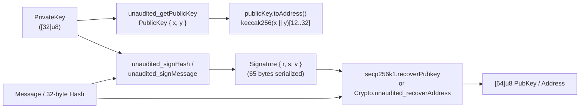

Voltaire splits secp256k1 ECDSA functionality across two modules under `@import("crypto")`:
- `crypto.secp256k1` (`src/crypto/secp256k1.zig`) — Curve constants, `AffinePoint` (wrapping `std.crypto.ecc.Secp256k1`), constant-time signature parameter validation, public-key recovery (`recoverPubkey`, `recoverPubkeyAllowHighS`), address recovery, and `verifySignature`.
- `crypto.Crypto` (`src/crypto/crypto.zig`) — High-level `PrivateKey` (`[32]u8`), `PublicKey`, `Signature` (`r: u256`, `s: u256`, `v: u8`), signing, message hashing (`hashMessage`), and `secureZeroMemory`.

<Warning>
**Audit boundary:** While `std.crypto.ecc.Secp256k1` underlies point arithmetic, the custom ECDSA signing and public-key recovery wrappers (`unaudited_*` functions) have **not** undergone an independent security audit. Do not custody production funds with unaudited signing paths without an external audit or `libsecp256k1`.
</Warning>

## Curve Constants & Signature Layout

| Constant | Value |
| :--- | :--- |
| `SECP256K1_P` | `0xFFFFFFFFFFFFFFFFFFFFFFFFFFFFFFFFFFFFFFFFFFFFFFFFFFFFFFFEFFFFFC2F` |
| `SECP256K1_N` | `0xFFFFFFFFFFFFFFFFFFFFFFFFFFFFFFFEBAAEDCE6AF48A03BBFD25E8CD0364141` |
| `SECP256K1_B` | `7` ($y^2 \equiv x^3 + 7 \pmod p$) |
| `SECP256K1_GX` | `0x79BE667EF9DCBBAC55A06295CE870B07029BFCDB2DCE28D959F2815B16F81798` |
| `SECP256K1_GY` | `0x483ADA7726A3C4655DA4FBFC0E1108A8FD17B448A68554199C47D08FFB10D4B8` |

65-byte compact signature (`Signature.toBytes()`):

| Byte Offset | Size | Field | Encoding |
| :--- | :--- | :--- | :--- |
| `0..32` | 32 bytes | `r` | Big-endian `u256`, $1 \le r < n$ |
| `32..64` | 32 bytes | `s` | Big-endian `u256`, $1 \le s \le \lfloor n/2 \rfloor$ (EIP-2 low-`s`) |
| `64` | 1 byte | `v` | Recovery ID `27` or `28` (or `0`/`1` parity) |

## Signing & Recovery Pipeline



## `crypto.secp256k1` API

All functions operate on the stack with zero heap allocation.

| Symbol | Signature | Notes |
| :--- | :--- | :--- |
| `AffinePoint` | `struct { x: u256, y: u256, infinity: bool }` | Methods: `zero`, `generator`, `isOnCurve`, `negate`, `double`, `add`, `scalarMul` |
| `unauditedValidateSignature` | `fn (r: u256, s: u256) bool` | Constant-time checks: $1 \le r < n$, $1 \le s \le \lfloor n/2 \rfloor$ |
| `recoverPubkey` | `fn (hash: []const u8, r: []const u8, s: []const u8, v: u8) ![64]u8` | Accepts `v` in `{0, 1, 27, 28}`; enforces EIP-2 low-`s`; returns `x \|\| y` |
| `recoverPubkeyAllowHighS` | `fn (hash: []const u8, r: []const u8, s: []const u8, v: u8) ![64]u8` | Permits high-`s` signatures as required by the `ECRECOVER` (`0x01`) precompile |
| `unauditedRecoverAddress` | `fn (hash: []const u8, recoveryId: u8, r: u256, s: u256) !Address` | Recovers 20-byte Ethereum address (`recoveryId` in `{0, 1}`) |
| `verifySignature` | `fn (hash: [32]u8, r: u256, s: u256, pub_key: AffinePoint) bool` | Constant-time final $r' \stackrel{?}{=} r$ check |

## `crypto.Crypto` API

| Symbol | Signature | Notes |
| :--- | :--- | :--- |
| `unaudited_randomPrivateKey` | `fn () !PrivateKey` | CSPRNG 32-byte key in $[1, n-1]$ |
| `unaudited_getPublicKey` | `fn (private_key: PrivateKey) !PublicKey` | Scalar multiply generator $G$ |
| `publicKeyToAddress` | `fn (public_key: PublicKey) Address` | Last 20 bytes of `keccak256(x_be \|\| y_be)` |
| `hashMessage` | `fn (message: []const u8) Hash.Hash` | EIP-191 personal message hash |
| `unaudited_signHash` | `fn (hash: Hash.Hash, private_key: PrivateKey) !Signature` | Signs raw 32-byte digest |
| `unaudited_signMessage` | `fn (message: []const u8, private_key: PrivateKey) !Signature` | Hashes with EIP-191 then signs |
| `unaudited_recoverAddress` | `fn (hash: Hash.Hash, signature: Signature) !Address` | Recovers signer from digest + signature |
| `unaudited_recoverMessageAddress` | `fn (message: []const u8, signature: Signature) !Address` | Recovers signer from EIP-191 message |
| `unaudited_verifySignature` | `fn (hash: Hash.Hash, signature: Signature, address: Address) !bool` | Recovers address and compares |
| `unaudited_verifyMessage` | `fn (message: []const u8, signature: Signature, address: Address) !bool` | EIP-191 verification |
| `secureZeroMemory` | `fn (ptr: anytype) void` | Volatile scrub for private keys on stack |

## Example

```zig
const std = @import("std");
const crypto_mod = @import("crypto");
const Crypto = crypto_mod.Crypto;
const secp256k1 = crypto_mod.secp256k1;

pub fn main() !void {
    // Generate keypair and zero private key on scope exit
    var priv = try Crypto.unaudited_randomPrivateKey();
    defer Crypto.secureZeroMemory(&priv);

    const pub_key = try Crypto.unaudited_getPublicKey(priv);
    const signer_addr = pub_key.toAddress();

    // Sign raw 32-byte digest
    const digest = crypto_mod.Hash.keccak256("payload");
    const sig = try Crypto.unaudited_signHash(digest, priv);

    // Recover 64-byte uncompressed public key via crypto.secp256k1
    const sig_bytes = sig.toBytes(); // [65]u8: r(32) || s(32) || v(1)
    const recovered_pub = try secp256k1.recoverPubkey(
        &digest,
        sig_bytes[0..32],
        sig_bytes[32..64],
        sig_bytes[64],
    );

    // Recover and verify 20-byte Ethereum address
    const recovered_addr = try Crypto.unaudited_recoverAddress(digest, sig);
    std.debug.assert(std.mem.eql(u8, &signer_addr.bytes, &recovered_addr.bytes));
    std.debug.assert(recovered_pub.len == 64);

    std.debug.print("Signer matches recovered address: {s}\n", .{&recovered_addr.toChecksummed()});
}
```

Sources: `packages/voltaire-zig/src/crypto/secp256k1.zig`, `packages/voltaire-zig/src/crypto/crypto.zig`
