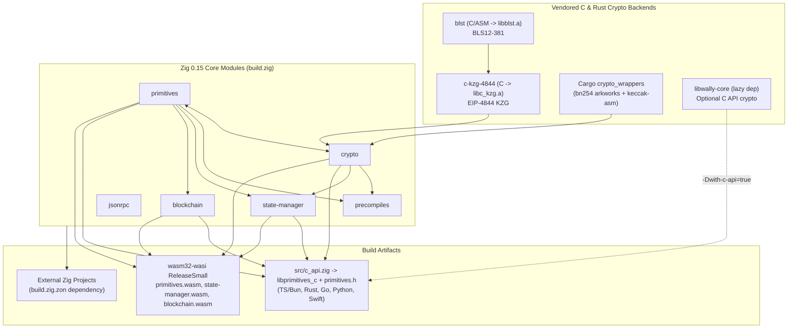

Voltaire compiles a single Zig 0.15 core (`packages/voltaire-zig/`) into four artifact classes: standalone Zig package modules, C static/shared libraries (`libprimitives_c`), domain-specific native FFI shared libraries (`libvoltaire_state_manager`, `libvoltaire_blockchain`), and `wasm32-wasi` reactor binaries.

## System Topology



## Directory Layout

```text
voltaire/
├── build.zig                       # Root Zig 0.15 build graph (modules, tests, C API, WASM, benches)
├── build.zig.zon                   # Package `.primitives`, minimum_zig_version = "0.15.1"
├── Cargo.toml                      # Rust workspace building crypto_wrappers
└── packages/
    └── voltaire-zig/
        ├── src/
        │   ├── root.zig            # Top-level re-export (Primitives + Crypto)
        │   ├── c_api.zig           # C ABI exports (also WASM reactor entrypoint)
        │   ├── primitives.h        # Auto-generated C header (`zig build generate-header`)
        │   ├── primitives/         # Core types + root.zig
        │   ├── crypto/             # Hash, curves, Rust FFI wrappers + root.zig
        │   ├── evm/                # Evm(config), Frame(config), HostInterface, precompiles/
        │   ├── state-manager/      # Account/storage state + state-manager/c_api.zig
        │   ├── blockchain/         # Block storage + blockchain/c_api.zig
        │   └── jsonrpc/            # Self-contained JSON-RPC types
        ├── lib/                    # Vendored C libraries (blst, c-kzg-4844, libwally-core, c_libs.zig)
        ├── examples/               # Runnable Zig and C examples (`zig build example-*`)
        └── docs/                   # Mintlify documentation
```

## Module Import Rules

Always import exported modules by module name rather than crossing module boundaries with relative file paths:

```zig
// Correct: uses module graph declared in build.zig
const primitives = @import("primitives");
const crypto = @import("crypto");
const precompiles = @import("precompiles");

// Incorrect: breaks module encapsulation and target-specific wiring (e.g. WASM vs native)
const Address = @import("../primitives/Address/address.zig").Address;
```

Within a single module (for example inside `src/primitives/Address/address.zig`), sibling files may use relative imports (`@import("../Rlp/Rlp.zig")`).

## Target-Conditional Compilation (Native vs WASM)

`build.zig` builds separate native and `wasm32-wasi` target graphs:
- **Native targets**: Link `blst` (assembly enabled), `c-kzg-4844`, and `libcrypto_wrappers.a` (Rust `arkworks` BN254 + `keccak-asm`). `crypto.bn254_arkworks` is active.
- **WASM targets (`wasm32-wasi`, `.ReleaseSmall` or `.ReleaseFast`)**:
  - Built as reactor executables (`entry = .disabled`, `rdynamic = true`) because WASM has no dynamic shared library loader.
  - `blst` compiles with `__BLST_PORTABLE__` and `__BLST_NO_ASM__`.
  - `c-kzg-4844` compiles as pure C.
  - `crypto_wrappers` compiles for `wasm32-unknown-unknown` with portable Rust features.
  - `crypto.bn254_arkworks` compiles to a stub returning `error.NotSupported` when `builtin.target.cpu.arch == .wasm32`; callers on WASM use the pure-Zig `crypto.bn254` implementation.

## C FFI & Multi-Language Boundary

`packages/voltaire-zig/src/c_api.zig` exposes flat C structs (`PrimitivesAddress`, `PrimitivesHash`, `PrimitivesU256`, `PrimitivesSignature`, `PrimitivesAuthorization`) and integer status codes (`PRIMITIVES_SUCCESS = 0`, negative error codes `-1` through `-22`).

Run `zig build generate-header` to regenerate `packages/voltaire-zig/src/primitives.h` from `c_api.zig`. Downstream language packages (`voltaire-c`, `voltaire-ts`, `voltaire-rs`, `voltaire-go`, `voltaire-py`, `voltaire-swift`) bind to these C symbols or to the corresponding WASM reactor exports.

## Build Options & Steps

| Command | Effect |
| :--- | :--- |
| `zig build test` | Runs unit tests for `primitives`, `crypto`, `precompiles`, `state-manager`, `blockchain`, and extra boundary tests |
| `zig build build-ts-wasm` | Builds `wasm/primitives.wasm`, `wasm/state-manager.wasm`, and `wasm/blockchain.wasm` (`ReleaseSmall`) |
| `zig build build-ts-wasm-fast` | Builds `wasm/primitives-fast.wasm` (`ReleaseFast`) |
| `zig build -Dwith-c-api=true` | Builds static & shared `libprimitives_c`, generates/installs `include/primitives.h` (requires `libwally-core`) |
| `zig build -Dwith-c-api=true test-c-api` | Compiles and runs C API tests against `libprimitives_c` |
| `zig build crypto-wasm` | Builds individual per-algorithm WASM modules for tree-shaking |
| `zig build bench` | Runs zBench microbenchmarks (add `-Dwith-benches=true` to install benchmark binaries) |

Sources: `build.zig`, `build.zig.zon`, `packages/voltaire-zig/src/c_api.zig`
