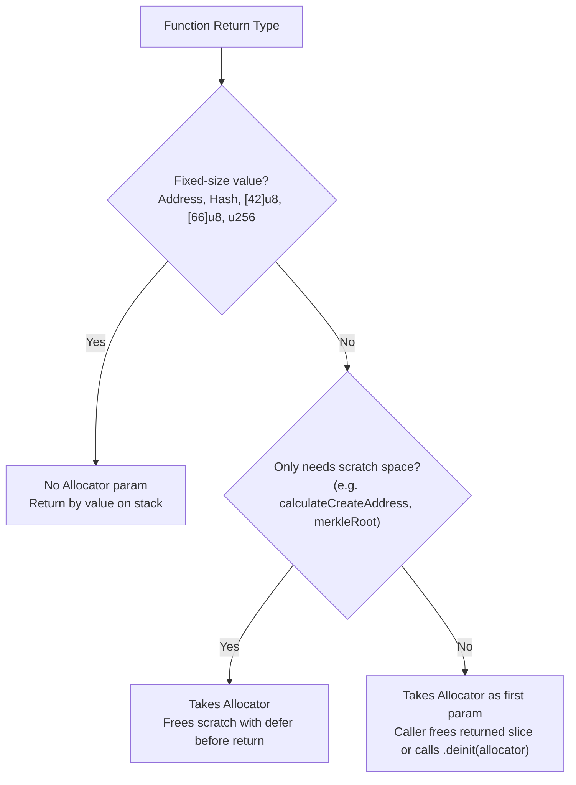

Voltaire targets Zig `0.15.1`+ (tested on `0.15.2`). This guide documents the idioms enforced across `packages/voltaire-zig/src/`.

## Allocator Ownership Matrix



### Fixed-Size Stack Returns First

Prefer stack-allocated fixed arrays whenever the output length is statically known:

```zig
// Stack-allocated [42]u8 — no allocator, cannot fail with OutOfMemory
const hex: [42]u8 = primitives.Address.toChecksummed(addr);

// Stack-allocated [4]u8 -> [10]u8 round-trip
const sel: [4]u8 = try primitives.Hex.hexToBytesFixed(4, "0xa9059cbb");
const sel_hex: [10]u8 = primitives.Hex.bytesToHexFixed(4, sel);
```

### `defer` and `errdefer` Hygiene

Every function that allocates intermediate buffers frees them with `defer`. Buffers that will be returned to the caller use `errdefer` so early errors never leak:

```zig
pub fn hexToBytes(allocator: std.mem.Allocator, hex: []const u8) ![]u8 {
    if (hex.len < 2 or !std.mem.eql(u8, hex[0..2], "0x")) return error.InvalidHexFormat;
    const digits = hex[2..];
    if (digits.len % 2 != 0) return error.OddLengthHex;

    const bytes = try allocator.alloc(u8, digits.len / 2);
    errdefer allocator.free(bytes); // Freed only if parsing fails below

    // ... decode nibbles into bytes ...
    return bytes; // Ownership transfers to caller
}
```

### Zero-Heap Stack Arenas (`FixedBufferAllocator`)

When calling an allocator-parameterized API (such as `Rlp.encode` or `Address.calculateCreateAddress`) on bounded inputs in a hot loop, supply a stack-backed `FixedBufferAllocator`:

```zig
var buf: [256]u8 = undefined;
var fba = std.heap.FixedBufferAllocator.init(&buf);
const contract = try primitives.Address.calculateCreateAddress(fba.allocator(), deployer, nonce);
```

## Zig 0.15 Unmanaged `ArrayList`

Zig 0.15 defaults `std.ArrayList(T)` to the unmanaged representation. Initialize with `.{}` (or `std.ArrayList(T){}`) and pass `allocator` to every mutating call and `deinit`:

```zig
// Zig 0.15 API
var list = std.ArrayList(u8){};
defer list.deinit(allocator);

try list.append(allocator, 0x60);
try list.appendSlice(allocator, &[_]u8{ 0x80, 0x60, 0x40, 0x52 });
const owned = try list.toOwnedSlice(allocator);
defer allocator.free(owned);
```

<Note>
Legacy `std.ArrayList(u8).init(allocator)` is removed in Zig 0.15. If a managed list is required for interoperability, use `std.array_list.AlignedManaged(u8, null).init(allocator)`, though new code should prefer unmanaged `std.ArrayList(T){}`.
</Note>

## Comptime Validation

Push static Ethereum literals to compile time so malformed hex fails the build rather than crashing at runtime:

```zig
const primitives = @import("primitives");
const crypto = @import("crypto");

const WETH_MAINNET = comptime primitives.Address.addressFromHex(
    "0xc02aaa39b223fe8d0a0e5c4f27ead9083c756cc2",
);
const EMPTY_HASH = comptime crypto.Hash.fromHexComptime(
    "0xc5d2460186f7233c927e7db2dcc703c0e500b653ca82273b7bfad8045d85a470",
);
```

## Error Unions & Explicit Handling

Never discard errors with `catch unreachable` on untrusted external input (hex strings, RLP wire bytes, ABI calldata, signatures). Define narrow error sets per module (`HexError`, `RlpError`, `AbiError`, `TransactionError`, `PrecompileError`) and propagate with `try`.

```zig
pub fn parseRecipient(raw: []const u8) !primitives.Address {
    const addr = try primitives.Address.fromHex(raw);
    if (primitives.Address.isZero(addr)) return error.ZeroRecipient;
    return addr;
}
```

## Constant-Time & Secret Scrubbing

Cryptographic comparisons and secret-key paths follow two strict rules:
1. Use `crypto.constant_time` helpers (`constantTimeEqU256`, `constantTimeLtU256`, `constantTimeSelectU256`) for signature scalar range checks and verification comparisons.
2. Scrub private key buffers before leaving scope using `defer crypto.Crypto.secureZeroMemory(&private_key);` (uses volatile stores so LLVM cannot elide the zeroing).

## Testing & Fuzzing

### Leak-Checked Unit Tests

Always use `std.testing.allocator` in `test` blocks. Any missing `free` or `deinit` fails `zig build test` automatically:

```zig
test "rlp round-trip frees all allocations" {
    const allocator = std.testing.allocator;
    const Rlp = @import("primitives").Rlp;

    const encoded = try Rlp.encode(allocator, "voltaire");
    defer allocator.free(encoded);

    const decoded = try Rlp.decode(allocator, encoded, false);
    defer decoded.data.deinit(allocator);

    try std.testing.expectEqualStrings("voltaire", decoded.data.String);
}
```

### Fuzz Tests

Parsers and cryptographic decoders ship colocated `*.fuzz.zig` harnesses (`Address/address.fuzz.zig`, `Hex/hex.fuzz.zig`, `Abi/Abi.fuzz.zig`, `trie.fuzz.zig`, `secp256k1.fuzz.zig`, `precompiles/*.fuzz.zig`). Run fuzzing with:

```bash
zig build test --fuzz
```

### Benchmarks

Performance-sensitive modules colocate `*.bench.zig` files powered by `zbench`. Run benchmarks with:

```bash
zig build bench
```
