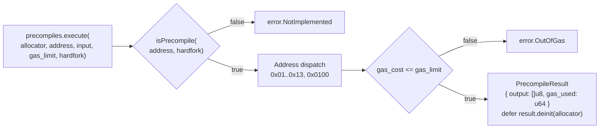

Voltaire provides two EVM layers in Zig:
1. **`@import("precompiles")`** (`src/evm/precompiles/root.zig`) — An exported Zig module implementing all 20 Ethereum precompiled contracts from Frontier (`0x01`–`0x04`) through Osaka (`0x0100` `P256VERIFY`).
2. **`src/evm/`** (`evm.zig`, `frame.zig`, `host.zig`, `instructions/`) — A comptime-parameterized EVM (`Evm(config)` and `Frame(config)`) with pluggable `HostInterface` vtable, access-list journaling, and bytecode/opcode primitives (`primitives.Bytecode`, `primitives.Opcode`, `primitives.OpcodeInfo`, `primitives.GasConstants`).

## Precompile Dispatch Architecture



## Precompiled Contracts (`@import("precompiles")`)

| Address | Constant | Module | Active Hardfork | Specification |
| :--- | :--- | :--- | :--- | :--- |
| `0x01` | `ECRECOVER_ADDRESS` | `ecrecover` | Frontier | secp256k1 public key recovery (allows high-`s`) |
| `0x02` | `SHA256_ADDRESS` | `sha256` | Frontier | SHA-256 digest |
| `0x03` | `RIPEMD160_ADDRESS` | `ripemd160` | Frontier | RIPEMD-160 digest (left-padded to 32 bytes) |
| `0x04` | `IDENTITY_ADDRESS` | `identity` | Frontier | Memory copy |
| `0x05` | `MODEXP_ADDRESS` | `modexp` | Byzantium | Arbitrary-precision modular exponentiation (EIP-198 / EIP-2565) |
| `0x06` | `ECADD_ADDRESS` | `bn254_add` | Byzantium | BN254 G1 addition (EIP-196) |
| `0x07` | `ECMUL_ADDRESS` | `bn254_mul` | Byzantium | BN254 G1 scalar multiplication (EIP-196) |
| `0x08` | `ECPAIRING_ADDRESS` | `bn254_pairing` | Byzantium | BN254 bilinear pairing check (EIP-197) |
| `0x09` | `BLAKE2F_ADDRESS` | `blake2f` | Istanbul | BLAKE2b `F` compression function (EIP-152) |
| `0x0A` | `POINT_EVALUATION_ADDRESS` | `point_evaluation` | Cancun | KZG point evaluation via `c-kzg-4844` (EIP-4844) |
| `0x0B` | `BLS12_G1ADD_ADDRESS` | `bls12_g1_add` | Prague | BLS12-381 G1 point addition (EIP-2537) |
| `0x0C` | `BLS12_G1MUL_ADDRESS` | `bls12_g1_mul` | Prague | BLS12-381 G1 scalar multiplication (EIP-2537) |
| `0x0D` | `BLS12_G1MSM_ADDRESS` | `bls12_g1_msm` | Prague | BLS12-381 G1 multi-scalar multiplication (EIP-2537) |
| `0x0E` | `BLS12_G2ADD_ADDRESS` | `bls12_g2_add` | Prague | BLS12-381 G2 point addition (EIP-2537) |
| `0x0F` | `BLS12_G2MUL_ADDRESS` | `bls12_g2_mul` | Prague | BLS12-381 G2 scalar multiplication (EIP-2537) |
| `0x10` | `BLS12_G2MSM_ADDRESS` | `bls12_g2_msm` | Prague | BLS12-381 G2 multi-scalar multiplication (EIP-2537) |
| `0x11` | `BLS12_PAIRING_ADDRESS` | `bls12_pairing` | Prague | BLS12-381 pairing check (EIP-2537) |
| `0x12` | `BLS12_MAP_FP_TO_G1_ADDRESS` | `bls12_map_fp_to_g1` | Prague | Map $F_p$ element to G1 (EIP-2537) |
| `0x13` | `BLS12_MAP_FP2_TO_G2_ADDRESS` | `bls12_map_fp2_to_g2` | Prague | Map $F_{p^2}$ element to G2 (EIP-2537) |
| `0x0100` | `P256VERIFY_ADDRESS` | `p256verify` | Osaka | secp256r1 (P-256) ECDSA verification, `6900` gas (EIP-7951) |

## Executing Precompiles

```zig
const std = @import("std");
const primitives = @import("primitives");
const precompiles = @import("precompiles");

pub fn main() !void {
    var gpa = std.heap.GeneralPurposeAllocator(.{}){};
    defer _ = gpa.deinit();
    const allocator = gpa.allocator();

    // Check hardfork availability
    std.debug.assert(!precompiles.isPrecompile(precompiles.P256VERIFY_ADDRESS, .PRAGUE));
    std.debug.assert(precompiles.isPrecompile(precompiles.P256VERIFY_ADDRESS, .OSAKA));

    // Dispatch SHA-256 precompile (0x02)
    const sha_res = try precompiles.execute(
        allocator,
        precompiles.SHA256_ADDRESS,
        "hello",
        10_000,
        .OSAKA,
    );
    defer sha_res.deinit(allocator);

    // Direct call to an individual precompile module
    const id_res = try precompiles.identity.execute(allocator, "voltaire", 1_000);
    defer id_res.deinit(allocator);

    std.debug.print("SHA256 gas={d}, bytes={d}\n", .{ sha_res.gas_used, sha_res.output.len });
    std.debug.print("IDENTITY output={s}, gas={d}\n", .{ id_res.output, id_res.gas_used });
}
```

### Precompile Result & Errors

```zig
pub const PrecompileResult = struct {
    output: []u8,
    gas_used: u64,

    pub fn deinit(self: PrecompileResult, allocator: std.mem.Allocator) void {
        allocator.free(self.output);
    }
};
```

`PrecompileError` includes `InvalidInput`, `InvalidSignature`, `InvalidPoint`, `InvalidPairing`, `OutOfGas`, `NotImplemented`, and `std.mem.Allocator.Error`.

## EVM Execution Core (`src/evm/`)

The Zig EVM implementation separates orchestration from per-call execution:

| Component | File | Responsibility |
| :--- | :--- | :--- |
| `Evm(config)` | `src/evm/evm.zig` | Comptime-configured EVM state: arena-backed account maps, `AccessListManager`, snapshot/revert stacks, `BlockContext`, `Hardfork`, `Tracer`, and nested `inner_call` orchestration |
| `Frame(config)` | `src/evm/frame.zig` | Per-frame execution state: `stack: std.ArrayList(u256)`, `memory: std.AutoHashMap(u32, u8)`, `pc`, `gas_remaining`, `Bytecode`, `calldata`, `return_data`, `is_static`, and 12 instruction handler tables |
| `HostInterface` | `src/evm/host.zig` | Type-erased vtable (`getBalance`, `setBalance`, `getCode`, `setCode`, `getStorage`, `setStorage`, `getNonce`, `setNonce`, `deleteAccount`) for external state backends |

Instruction handlers under `src/evm/` cover all 12 categories: `arithmetic`, `comparison`, `bitwise`, `keccak`, `context`, `block`, `stack`, `memory`, `storage`, `control`, `log`, and `system`. For standalone bytecode disassembly, JUMPDEST indexing, and static gas accounting, see [Bytecode](/primitives/bytecode).

Sources: `packages/voltaire-zig/src/evm/precompiles/root.zig`, `packages/voltaire-zig/src/evm/evm.zig`, `packages/voltaire-zig/src/evm/frame.zig`, `packages/voltaire-zig/src/evm/host.zig`
