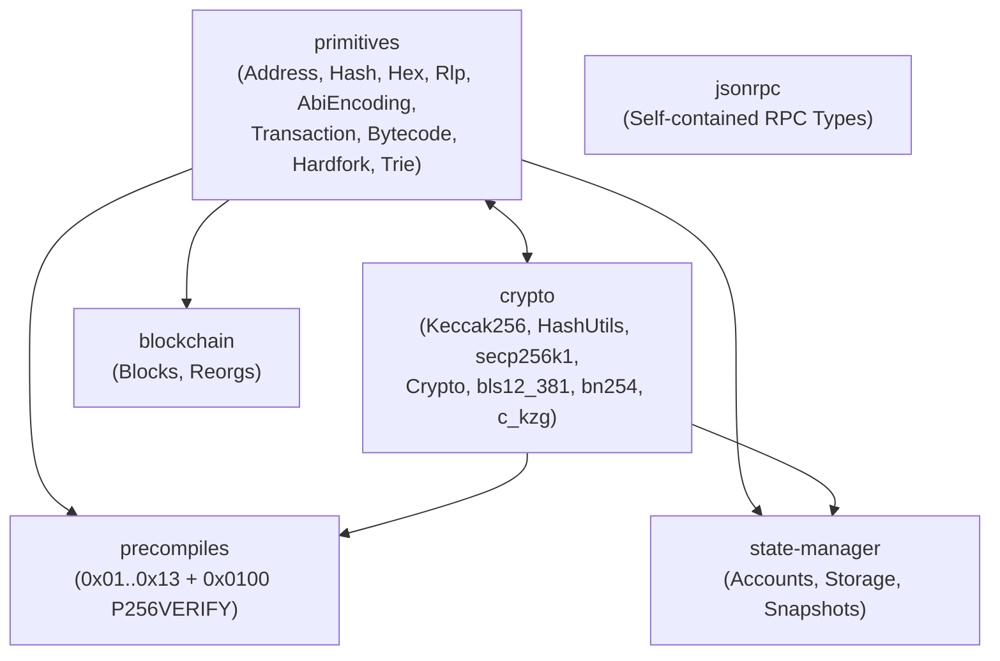

Voltaire is an Ethereum primitives, cryptography, and execution library written in Zig 0.15. Each type maps directly to its canonical Ethereum byte representation, exposes explicit allocator boundaries, and compiles to native binaries, C shared libraries, and WebAssembly modules from a single codebase.

## Design Properties

- **Exact value representations**: `Address` is `struct { bytes: [20]u8 }`; `Hash` is `[32]u8`; `Selector` is `[4]u8`. Fixed-size operations execute on the stack without heap allocation.
- **Explicit memory ownership**: Every function that allocates takes `std.mem.Allocator` and returns an owned slice or struct with a `deinit(allocator)` method. No global allocator or hidden heap traffic exists.
- **Compile-time validation**: Static literals can be validated at compile time with `Address.addressFromHex` and `crypto.Hash.fromHexComptime`, failing compilation on malformed hex.
- **Multi-target core**: The same Zig modules compile natively (`x86_64`, `aarch64`), to `wasm32-wasi` reactor binaries, and behind a C ABI (`src/c_api.zig` -> `primitives.h`) consumed by TypeScript, Rust, Go, Python, and Swift.

## Module Graph



`primitives` and `crypto` cross-import through Zig's lazy module resolution in `build.zig`. `jsonrpc` is self-contained and has no dependency on `primitives` or `crypto`.

## Quick Example

```zig
const std = @import("std");
const primitives = @import("primitives");
const crypto = @import("crypto");

const Address = primitives.Address;
const Hash = primitives.Hash;
const Rlp = primitives.Rlp;

pub fn main() !void {
    var gpa = std.heap.GeneralPurposeAllocator(.{}){};
    defer _ = gpa.deinit();
    const allocator = gpa.allocator();

    // Parse and EIP-55 checksum an address (stack-only, returns [42]u8)
    const addr = try Address.fromHex("0x742d35cc6634c0532925a3b844bc9e7595f51e3e");
    const checksum = Address.toChecksummed(addr);

    // Keccak-256 hash (stack-only, returns [32]u8)
    const digest = Hash.keccak256("hello");
    const digest_hex = crypto.Hash.toHex(digest); // [66]u8 on stack

    // RLP encode a list (heap-allocated, caller frees)
    const list = [_][]const u8{ "cat", "dog" };
    const encoded = try Rlp.encode(allocator, list[0..]);
    defer allocator.free(encoded);

    // Analyze EVM bytecode jump destinations
    const raw_code = [_]u8{ 0x60, 0x04, 0x56, 0x00, 0x5b, 0x00 };
    var bytecode = try primitives.Bytecode.init(allocator, &raw_code);
    defer bytecode.deinit();

    std.debug.print("Address:   {s}\n", .{&checksum});
    std.debug.print("Keccak256: {s}\n", .{&digest_hex});
    std.debug.print("RLP bytes: {d}\n", .{encoded.len});
    std.debug.print("PC 4 valid JUMPDEST: {}\n", .{bytecode.isValidJumpDest(4)});
}
```

## Exported Modules

| Import Name | Primary Types & Namespaces |
| :--- | :--- |
| `@import("primitives")` | `Address`, `Hash`, `Bytes32`, `Hex`, `Rlp`, `AbiEncoding`, `Transaction`, `Bytecode`, `Opcode`, `Hardfork`, `GasConstants`, `FeeMarket`, `Denomination`, `Trie`, `Ssz` |
| `@import("crypto")` | `Keccak256`, `Hash`, `HashUtils`, `Keccak256_Accel`, `keccak_asm`, `Crypto`, `secp256k1`, `bls12_381`, `bn254`, `bn254_arkworks`, `c_kzg`, `ModExp`, `Blake2`, `Ripemd160`, `Eip712`, `bip39` |
| `@import("precompiles")` | `execute`, `isPrecompile`, `ecrecover`, `sha256`, `ripemd160`, `identity`, `modexp`, `bn254_*`, `blake2f`, `point_evaluation`, `bls12_*`, `p256verify` |
| `@import("state-manager")` | `StateManager`, `ForkBackend`, snapshot/revert journals |
| `@import("blockchain")` | `Blockchain`, block headers/bodies, canonical head management |
| `@import("jsonrpc")` | Hand-written Ethereum JSON-RPC types and method definitions |

## Next Steps

- [Getting Started](/getting-started) — Add Voltaire to `build.zig.zon` and run your first build.
- [Tutorial: First Ethereum CLI Tool](/tutorials/first-ethereum-tool) — Build a zero-allocation address, Keccak-256, and RLP utility in Zig.
- [Architecture](/dev/architecture) — Inspect the build graph, vendored native crypto, and FFI boundary.
- [Library Comparisons](/comparisons) — Compare Voltaire Zig against Alloy (Rust), go-ethereum, and TypeScript libraries.
