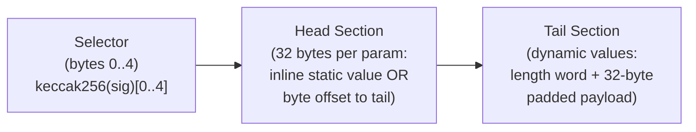

`primitives.AbiEncoding` implements the Ethereum Contract ABI specification: 4-byte function selectors, 32-byte head/tail parameter encoding and decoding, `abi.encodePacked`, event topic encoding, and revert error encoding.

<Note>
Import `primitives.AbiEncoding` directly (rather than `primitives.Abi`). `Abi.zig` is a thin re-export wrapper whose `uint256Value` alias lags behind `AbiEncoding.uint256_value`.
</Note>

## Head / Tail Calldata Layout



| Limit Constant | Value | Purpose |
| :--- | :--- | :--- |
| `MAX_ABI_LENGTH` | `10 * 1024 * 1024` (10 MiB) | Bounds dynamic allocation size against memory-exhaustion DoS |
| `MAX_RECURSION_DEPTH` | `64` | Bounds nested array decoding depth |

## Types (`AbiType` & `AbiValue`)

`AbiType` is an enum covering static integers (`uint8`..`uint256`, `int8`..`int256`), `address`, `bool`, fixed bytes (`bytes1`, `bytes2`, `bytes3`, `bytes4`, `bytes8`, `bytes16`, `bytes32`), dynamic types (`bytes`, `string`, `uint256[]`, `bytes32[]`, `address[]`, `string[]`, `bool[]`, `uint256[][]`), and fixed arrays (`uint256[2]`, `uint256[3]`, `address[2]`, `bool[4]`, `bytes4[2]`).

`AbiValue` is `union(AbiType)`. Convenience constructors:
- `uint256_value(val: u256) AbiValue`
- `boolValue(val: bool) AbiValue`
- `addressValue(val: Address) AbiValue`
- `stringValue(val: []const u8) AbiValue`
- `bytesValue(val: []const u8) AbiValue`

## API Reference

| Function | Signature | Allocates | Notes |
| :--- | :--- | :--- | :--- |
| `computeSelector` | `fn (signature: []const u8) [4]u8` | No | First 4 bytes of `keccak256(signature)` |
| `createFunctionSignature` | `fn (Allocator, name: []const u8, types: []const AbiType) ![]u8` | Yes | Formats `"name(type1,type2)"` |
| `encodeAbiParameters` | `fn (Allocator, values: []const AbiValue) ![]u8` | Yes | Standard 32-byte padded head/tail encoding |
| `decodeAbiParameters` | `fn (Allocator, data: []const u8, types: []const AbiType) ![]AbiValue` | Yes | Caller frees slice and any dynamic child slices |
| `encodeFunctionData` | `fn (Allocator, selector: [4]u8, params: []const AbiValue) ![]u8` | Yes | Prepends 4-byte selector to encoded params |
| `decodeFunctionData` | `fn (Allocator, data: []const u8, types: []const AbiType) AbiError!struct { selector: [4]u8, parameters: []AbiValue }` | Yes | Splits 4-byte selector and decodes parameters |
| `encodeFunctionResult` | `fn (Allocator, return_values: []const AbiValue) ![]u8` | Yes | Encodes return values without selector |
| `decodeFunctionResult` | `fn (Allocator, data: []const u8, output_types: []const AbiType) ![]AbiValue` | Yes | Decodes contract return data |
| `encodeErrorResult` | `fn (Allocator, selector: [4]u8, params: []const AbiValue) ![]u8` | Yes | Encodes Solidity custom error revert payload |
| `encodePacked` | `fn (Allocator, values: []const AbiValue) ![]u8` | Yes | Non-standard tight packing (`abi.encodePacked`) |
| `encodeEventTopics` | `fn (Allocator, event_sig: []const u8, indexed: []const AbiValue) ![][]u8` | Yes | Topic 0 (`keccak256(sig)`) + indexed parameter topics |
| `decodeEventLog` | `fn (Allocator, event: EventDefinition, topics: []const [32]u8, data: []const u8) ![]AbiValue` | Yes | Decodes indexed topics and unindexed log data |
| `estimateGasForData` | `fn (data: []const u8) u64` | No | Calldata intrinsic gas (4 gas per zero byte, 16 per non-zero byte) |

## Allocator Ownership on Decode

`decodeAbiParameters` and `decodeFunctionData` allocate both the outer `[]AbiValue` slice and any heap-backed dynamic fields inside it (`.string`, `.bytes`, `.@"uint256[]"`, `.@"bytes32[]"`, `.@"address[]"`, `.@"string[]"`). Free inner dynamic slices before freeing the outer slice (or decode into an `std.heap.ArenaAllocator`).

## Example

```zig
const std = @import("std");
const primitives = @import("primitives");
const abi = primitives.AbiEncoding;
const Address = primitives.Address;

pub fn main() !void {
    var gpa = std.heap.GeneralPurposeAllocator(.{}){};
    defer _ = gpa.deinit();
    const allocator = gpa.allocator();

    // 1. Compute 4-byte selector on stack: 0xa9059cbb
    const selector = abi.computeSelector("transfer(address,uint256)");
    const recipient = comptime Address.addressFromHex("0xd8da6bf26964af9d7eed9e03e53415d37aa96045");

    // 2. Encode calldata (4 + 32 + 32 = 68 bytes)
    const params = [_]abi.AbiValue{
        abi.addressValue(recipient),
        abi.uint256_value(1_000_000_000_000_000_000),
    };
    const calldata = try abi.encodeFunctionData(allocator, selector, &params);
    defer allocator.free(calldata);

    // 3. Decode calldata back into typed AbiValue slice
    const types = [_]abi.AbiType{ .address, .uint256 };
    const decoded = try abi.decodeFunctionData(allocator, calldata, &types);
    defer freeAbiValues(allocator, decoded.parameters);

    std.debug.print("Calldata bytes: {d}\n", .{calldata.len});
    std.debug.print("Recipient:      {s}\n", .{&Address.toChecksummed(decoded.parameters[0].address)});
    std.debug.print("Amount:         {d}\n", .{decoded.parameters[1].uint256});
}

fn freeAbiValues(allocator: std.mem.Allocator, values: []abi.AbiValue) void {
    for (values) |val| {
        switch (val) {
            .string, .bytes => |s| allocator.free(s),
            .@"uint256[]" => |a| allocator.free(a),
            .@"bytes32[]" => |a| allocator.free(a),
            .@"address[]" => |a| allocator.free(a),
            .@"bool[]" => |a| allocator.free(a),
            .@"string[]" => |arr| {
                for (arr) |s| allocator.free(s);
                allocator.free(arr);
            },
            else => {},
        }
    }
    allocator.free(values);
}
```

## Error Set (`AbiEncoding.AbiError`)

`InvalidLength`, `InvalidType`, `InvalidData`, `InvalidSelector`, `DataTooSmall`, `ZeroData`, `OutOfBounds`, `InvalidAddress`, `InvalidUtf8`, `UnsupportedType`, `OutOfMemory`, `MaxLengthExceeded`, `MaxRecursionDepthExceeded`, `IntegerCastOverflow`.

Source: `packages/voltaire-zig/src/primitives/Abi/abi_encoding.zig`
