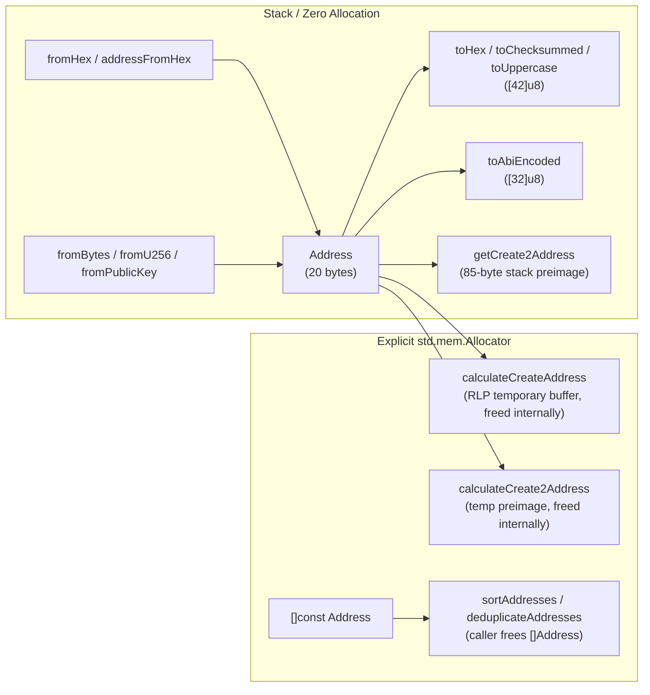

`primitives.Address` is a 20-byte value type (`struct { bytes: [20]u8 }`) representing an Ethereum externally owned account (EOA) or smart contract. Because `pub const Address = @This();` in `src/primitives/Address/address.zig`, every function taking `Address` as its first parameter supports both namespace syntax (`Address.toChecksummed(addr)`) and method syntax (`addr.toChecksummed()`).

## Memory & Allocator Model



## Byte Layout

| Representation | Size | Format |
| :--- | :--- | :--- |
| `Address.bytes` | 20 bytes | Raw big-endian account bytes |
| `toHex` / `toLowercase` / `toUppercase` / `toChecksummed` | 42 bytes (`[42]u8`) | `"0x"` + 40 ASCII hex characters |
| `toShortHex` | 14 bytes (`[14]u8`) | `"0x"` + first 6 hex chars + `"..."` + last 3 hex chars |
| `toAbiEncoded` | 32 bytes (`[32]u8`) | 12 leading zero bytes (`0..12`) + 20 address bytes (`12..32`) |

## Constants

| Constant | Value |
| :--- | :--- |
| `Address.ZERO_ADDRESS` / `Address.ZERO` | `Address{ .bytes = [_]u8{0} ** 20 }` |

## Construction & Parsing

| Function | Signature | Allocates | Notes |
| :--- | :--- | :--- | :--- |
| `zero` | `fn zero() Address` | No | Returns `ZERO_ADDRESS` |
| `fromHex` | `fn fromHex(hex_str: []const u8) !Address` | No | Accepts 40 chars or `0x`/`0X` + 40 chars |
| `addressFromHex` | `fn addressFromHex(comptime hex: [42]u8) Address` | No | Compile-time validation; requires `0x` |
| `fromBytes` | `fn fromBytes(bytes: []const u8) FromBytesError!Address` | No | Fails with `error.InvalidAddressLength` if `bytes.len != 20` |
| `fromU256` | `fn fromU256(value: u256) Address` | No | Takes low 160 bits in big-endian order |
| `fromNumber` | `fn fromNumber(value: anytype) Address` | No | Accepts any integer or `comptime_int` |
| `fromPublicKey` | `fn fromPublicKey(x: u256, y: u256) Address` | No | Last 20 bytes of `keccak256(x_be \|\| y_be)` |
| `addressFromPublicKey` | `fn addressFromPublicKey(pk: PublicKey) Address` | No | Derives from `Address.PublicKey` |
| `fromAbiEncoded` | `fn fromAbiEncoded(bytes: []const u8) !Address` | No | Reads `bytes[12..32]`; fails if `bytes.len != 32` |
| `fromBase64` | `fn fromBase64(allocator: Allocator, b64: []const u8) !Address` | No | Decodes into stack buffer; expects 20 decoded bytes |

```zig
const primitives = @import("primitives");
const Address = primitives.Address;

// Compile-time validated literal
const factory = comptime Address.addressFromHex("0x742d35cc6634c0532925a3b844bc9e7595f51e3e");

// Runtime hex parsing (with or without 0x)
const a = try Address.fromHex("0x742d35Cc6634C0532925a3b844Bc9e7595f51e3e");
const b = try Address.fromHex("742d35cc6634c0532925a3b844bc9e7595f51e3e");

// From raw bytes, u256, or uncompressed secp256k1 coordinates
const from_raw = try Address.fromBytes(&a.bytes);
const precompile_sha256 = Address.fromU256(0x02);
const derived = Address.fromPublicKey(pub_x, pub_y);
```

## Formatting & Conversion

| Function | Return Type | Notes |
| :--- | :--- | :--- |
| `toHex` / `toLowercase` / `addressToHex` | `[42]u8` | Lowercase `"0x..."` |
| `toChecksummed` / `addressToChecksumHex` | `[42]u8` | EIP-55 mixed-case checksum `"0x..."` |
| `toUppercase` | `[42]u8` | Uppercase `"0x..."` |
| `formatWithCase(addr, uppercase)` | `[42]u8` | Case-controlled `"0x..."` |
| `toShortHex` | `[14]u8` | `"0x742d35...e3e"` |
| `toAbiEncoded` | `[32]u8` | Left-padded with 12 zero bytes |
| `toU256` | `u256` | Big-endian 160-bit integer widened to `u256` |
| `toBytes` | `[20]u8` | Value copy of `address.bytes` |
| `clone` | `Address` | Explicit value copy |

`Address` implements `format`, so `std.debug.print("{f}", .{addr})` (or `{s}` on `&Address.toChecksummed(addr)`) works directly.

## Validation, Comparison & Collections

| Function | Signature | Notes |
| :--- | :--- | :--- |
| `isValid` / `isValidAddress` | `fn ([]const u8) bool` | Checks 40 or `0x`+40 hex chars |
| `isValidChecksum` / `isValidChecksumAddress` | `fn ([]const u8) bool` | Verifies EIP-55 checksum casing |
| `isZero` | `fn (Address) bool` | True iff all 20 bytes are `0x00` |
| `equals` / `eql` | `fn (Address, Address) bool` | Exact 20-byte comparison |
| `compare` | `fn (Address, Address) i8` | Lexicographic byte order: `-1`, `0`, or `1` |
| `lessThan` / `greaterThan` | `fn (Address, Address) bool` | Convenience wrappers over `compare` |
| `areAddressesEqual` | `fn ([]const u8, []const u8) !bool` | Parses two hex strings and compares bytes |
| `sortAddresses` | `fn (Allocator, []const Address) ![]Address` | Returns newly allocated sorted slice (caller frees) |
| `deduplicateAddresses` | `fn (Allocator, []const Address) ![]Address` | Preserves first-seen order; returns owned slice (caller frees) |

<Note>
When `addresses.len == 0`, `sortAddresses` and `deduplicateAddresses` return `&[_]Address{}`. Only call `allocator.free(slice)` when `slice.len > 0` (or guard with `if (result.len > 0) allocator.free(result)`).
</Note>

## Contract Address Derivation (`CREATE` & `CREATE2`)

| Function | Signature | Allocates | Formula |
| :--- | :--- | :--- | :--- |
| `calculateCreateAddress` / `getContractAddress` | `fn (Allocator, Address, u64) CalculateAddressError!Address` | Temporary (freed internally) | `keccak256(rlp([creator, nonce]))[12..32]` |
| `calculateCreate2Address` | `fn (Allocator, Address, u256, []const u8) CalculateCreate2AddressError!Address` | Temporary (freed internally) | `keccak256(0xff \|\| creator \|\| salt_be \|\| keccak256(init_code))[12..32]` |
| `getCreate2Address` | `fn (Address, [32]u8, [32]u8) Address` | **No (stack `[85]u8`)** | `keccak256(0xff \|\| creator \|\| salt \|\| init_code_hash)[12..32]` |

```zig
const std = @import("std");
const primitives = @import("primitives");
const Address = primitives.Address;
const Hash = primitives.Hash;

pub fn deriveAddresses(allocator: std.mem.Allocator) !void {
    const deployer = comptime Address.addressFromHex("0x6ac7ea33f8831ea9dcc53393aaa88b25a785dbf0");

    // CREATE at nonce 0 -> 0xcd234a471b72ba2f1ccf0a70fcaba648a5eecd8d
    const create_addr = try Address.calculateCreateAddress(allocator, deployer, 0);

    // Zero-allocation CREATE2 using pre-hashed init code
    const salt = [_]u8{0} ** 31 ++ [_]u8{0x42};
    const init_code = [_]u8{ 0x60, 0x80, 0x60, 0x40, 0x52 };
    const init_hash = Hash.keccak256(&init_code);
    const create2_addr = Address.getCreate2Address(deployer, salt, init_hash);

    std.debug.print("CREATE:  {s}\n", .{&Address.toChecksummed(create_addr)});
    std.debug.print("CREATE2: {s}\n", .{&Address.toChecksummed(create2_addr)});
}
```

## Error Set

| Error | Returned By | Condition |
| :--- | :--- | :--- |
| `error.InvalidHexFormat` | `fromHex` | Length != 40 (no prefix) or != 42 (`0x`/`0X` prefix) |
| `error.InvalidHexString` | `fromHex`, `PublicKey.fromHex` | Non-hexadecimal character in input |
| `error.InvalidAddressLength` | `fromBytes`, `fromBase64` | Decoded byte count != 20 |
| `error.InvalidAbiEncodedLength` | `fromAbiEncoded` | Input slice length != 32 |
| `error.OutOfMemory` | `calculateCreateAddress`, `calculateCreate2Address`, `sortAddresses`, `deduplicateAddresses` | Allocator failed |

Source: `packages/voltaire-zig/src/primitives/Address/address.zig`
