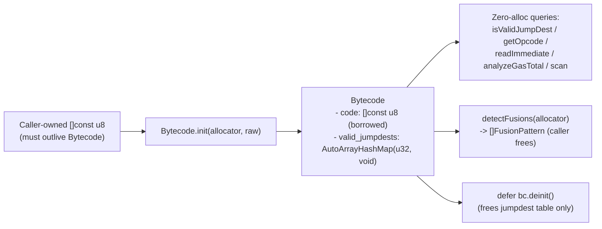

`primitives.Bytecode` wraps a borrowed raw bytecode slice (`[]const u8`) together with a precomputed `std.AutoArrayHashMap(u32, void)` of valid `JUMPDEST` (`0x5b`) offsets, skipping immediate bytes belonging to `PUSH1` (`0x60`) through `PUSH32` (`0x7f`).

## Struct & Ownership



`Bytecode.init` does **not** copy `code`; the caller must keep the underlying byte slice alive until `bc.deinit()` completes.

## API Reference

| Method / Function | Signature | Allocates | Notes |
| :--- | :--- | :--- | :--- |
| `init` / `fromUint8Array` | `fn (Allocator, code: []const u8) !Bytecode` | Yes | Scans `code` once to index all valid `JUMPDEST` offsets |
| `deinit` | `fn (*Bytecode) void` | No | Frees `valid_jumpdests` hash map |
| `isValidJumpDest` | `fn (*const Bytecode, pc: u32) bool` | No | $O(1)$ lookup; returns `false` for `0x5b` inside `PUSH` immediates |
| `len` | `fn (*const Bytecode) usize` | No | Returns `self.code.len` |
| `getOpcode` | `fn (*const Bytecode, pc: u32) ?u8` | No | Raw opcode byte at `pc`, or `null` if out of bounds |
| `getOpcodeEnum` | `fn (*const Bytecode, pc: u32) ?Opcode` | No | Typed `primitives.Opcode` enum at `pc` |
| `readImmediate` | `fn (*const Bytecode, pc: u32, size: u8) ?u256` | No | Reads `size` big-endian immediate bytes after `pc` (`null` if truncated) |
| `getNextPc` | `fn (*const Bytecode, current_pc: u32) ?u32` | No | Advances by `1 + push_size` for `PUSH1..PUSH32`, or `1` otherwise |
| `scan` | `fn (*const Bytecode, start_pc: u32, end_pc: u32) Scanner` | No | Stack iterator yielding `?Instruction` (`pc`, `opcode`, `size`, `push_value`) |
| `analyzeGasTotal` | `fn (*const Bytecode) u64` | No | Sums static opcode base gas costs across `code`, skipping `PUSH` immediates |
| `detectFusions` | `fn (*const Bytecode, Allocator) ![]FusionPattern` | Yes (caller frees) | Detects peephole pairs: `push_jump`, `push_jumpi`, `push_add`, `push_mul`, `push_sub`, `push_div`, `push_dup`, `push_swap`, `dup_swap`, `swap_pop` |

## Example

```zig
const std = @import("std");
const primitives = @import("primitives");
const Bytecode = primitives.Bytecode;

pub fn main() !void {
    var gpa = std.heap.GeneralPurposeAllocator(.{}){};
    defer _ = gpa.deinit();
    const allocator = gpa.allocator();

    // PUSH1 0x5b (data byte 0x5b is NOT a JUMPDEST!), POP, PUSH1 0x05, JUMP, JUMPDEST, STOP
    const raw = [_]u8{ 0x60, 0x5b, 0x50, 0x60, 0x05, 0x56, 0x5b, 0x00 };

    var bc = try Bytecode.init(allocator, &raw);
    defer bc.deinit();

    std.debug.assert(!bc.isValidJumpDest(1)); // inside PUSH1 immediate
    std.debug.assert(bc.isValidJumpDest(6));  // real JUMPDEST

    // Iterate instructions without allocating
    var scanner = bc.scan(0, @intCast(bc.len()));
    while (scanner.next()) |inst| {
        if (inst.push_value) |imm| {
            std.debug.print("pc={d:0>2} op=0x{x:0>2} imm=0x{x}\n", .{ inst.pc, inst.opcode, imm });
        } else {
            std.debug.print("pc={d:0>2} op=0x{x:0>2}\n", .{ inst.pc, inst.opcode });
        }
    }

    // Detect peephole fusion opportunities (PUSH1 + JUMP at pc=3)
    const fusions = try bc.detectFusions(allocator);
    defer allocator.free(fusions);

    std.debug.print("Static gas: {d}, Fusions: {d}\n", .{ bc.analyzeGasTotal(), fusions.len });
}
```

Source: `packages/voltaire-zig/src/primitives/Bytecode/bytecode.zig`
