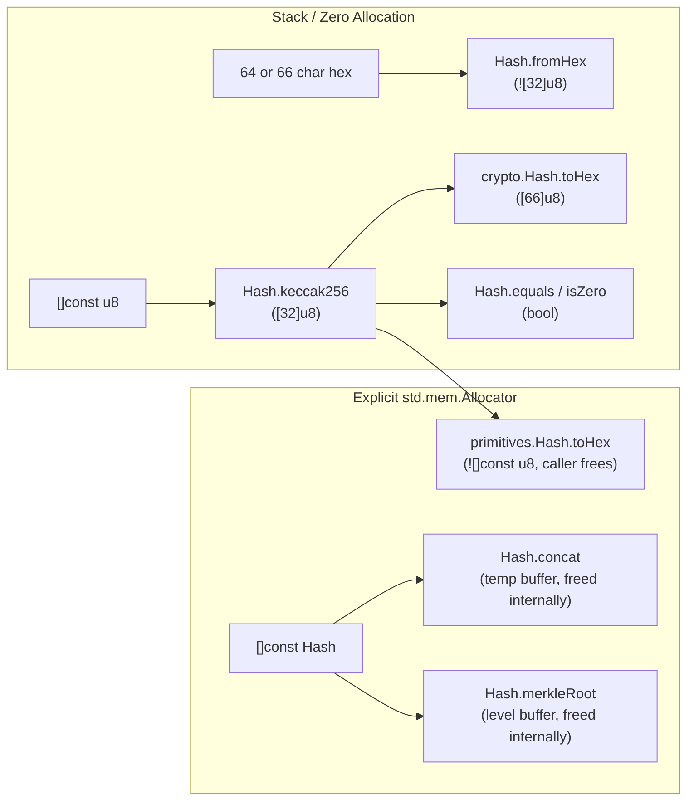

`primitives.Hash.Hash` is a fixed 32-byte array (`[32]u8`) representing Ethereum digests: Keccak-256 hashes, transaction hashes, block hashes, state roots, and storage keys.

Voltaire exposes two complementary hash namespaces:
- `primitives.Hash` (`src/primitives/Hash/Hash.zig`) — 32-byte `Hash`, `keccak256`, `concat`, `merkleRoot`, and generic `from(anytype)`.
- `crypto.Hash` / `crypto.HashUtils` (`src/crypto/hash_utils.zig`) — stack-allocated `toHex` (`[66]u8`), `fromHexComptime`, bitwise operations (`xor`, `bitAnd`, `bitOr`, `bitNot`), `selectorFromSignature`, `eip191HashMessage`, and `toU256`/`fromU256`.

## Memory & Allocator Model



## Constants

| Constant | Module | Value |
| :--- | :--- | :--- |
| `Hash.SIZE` | `primitives.Hash` | `32` |
| `Hash.ZERO` | `primitives.Hash` | `[_]u8{0} ** 32` |
| `crypto.Hash.EMPTY_KECCAK256` | `crypto.Hash` | `0xc5d2460186f7233c927e7db2dcc703c0e500b653ca82273b7bfad8045d85a470` |

## `primitives.Hash` API

| Function | Signature | Allocates | Notes |
| :--- | :--- | :--- | :--- |
| `fromBytes` | `fn fromBytes(bytes: []const u8) Hash` | No | Asserts `bytes.len == 32`; copies into `[32]u8` |
| `fromHex` | `fn fromHex(hex: []const u8) !Hash` | No | Accepts 64 chars or `"0x"` + 64 chars |
| `from` | `fn from(value: anytype) !Hash` | No | Accepts `Hash`, 32-byte slice/array, or 64/66-char hex |
| `toBytes` | `fn toBytes(hash: *const Hash) []const u8` | No | Returns 32-byte slice view |
| `toHex` / `toString` / `format` | `fn toHex(hash: *const Hash, allocator: Allocator) ![]const u8` | Yes | Returns owned `"0x..."` (66 bytes); caller frees |
| `equals` | `fn equals(a: *const Hash, b: *const Hash) bool` | No | Byte-for-byte equality |
| `isZero` | `fn isZero(hash: *const Hash) bool` | No | True iff all 32 bytes are `0x00` |
| `isValidHex` | `fn isValidHex(hex: []const u8) bool` | No | Validates 64 or `"0x"` + 64 hex chars |
| `isHash` | `fn isHash(value: anytype) bool` | No | Comptime type guard for `Hash`, `*Hash`, `*const Hash` |
| `clone` | `fn clone(hash: *const Hash) Hash` | No | Returns independent value copy |
| `slice` | `fn slice(hash: *const Hash, start: usize, end: usize) []const u8` | No | Sub-slice view of `hash` |
| `random` | `fn random() Hash` | No | Fills 32 bytes via `std.crypto.random.bytes` |
| `keccak256` / `keccak256String` | `fn keccak256(data: []const u8) Hash` | No | Computes Keccak-256 via `std.crypto.hash.sha3.Keccak256` |
| `concat` | `fn concat(allocator: Allocator, hashes: []const Hash) !Hash` | Temporary | Concatenates all 32-byte hashes and returns Keccak-256 |
| `merkleRoot` | `fn merkleRoot(allocator: Allocator, hashes: []const Hash) !Hash` | Temporary | Binary Keccak-256 Merkle root; odd leaf duplicates itself; empty returns `ZERO` |

<Warning>
Avoid `primitives.Hash.keccak256Hex` outside tests: its current implementation allocates via `std.testing.allocator`. To hash a hex string in production code, decode with `Hex.hexToBytes` (or `Hex.hexToBytesFixed`) and call `Hash.keccak256` on the decoded bytes.
</Warning>

## Zero-Allocation Formatting & Comptime Parsing (`crypto.Hash`)

For hot paths where heap allocation is undesirable, use `crypto.Hash` (`crypto.HashUtils`):

```zig
const std = @import("std");
const primitives = @import("primitives");
const crypto = @import("crypto");

const Hash = primitives.Hash;
const CryptoHash = crypto.Hash;

pub fn main() !void {
    var gpa = std.heap.GeneralPurposeAllocator(.{}){};
    defer _ = gpa.deinit();
    const allocator = gpa.allocator();

    // Comptime-checked 32-byte literal (requires "0x" + 64 hex chars)
    const empty_expected = comptime CryptoHash.fromHexComptime(
        "0xc5d2460186f7233c927e7db2dcc703c0e500b653ca82273b7bfad8045d85a470",
    );

    // Stack-only Keccak-256 and stack-only [66]u8 hex formatting
    const empty_digest = Hash.keccak256("");
    std.debug.assert(Hash.equals(&empty_digest, &empty_expected));
    const hex_buf: [66]u8 = CryptoHash.toHex(empty_digest);

    // Binary Merkle root over leaf hashes
    const leaves = [_]Hash.Hash{
        Hash.keccak256("leaf-0"),
        Hash.keccak256("leaf-1"),
        Hash.keccak256("leaf-2"),
    };
    const root = try Hash.merkleRoot(allocator, &leaves);

    std.debug.print("Empty: {s}\n", .{&hex_buf});
    std.debug.print("Root:  {s}\n", .{&CryptoHash.toHex(root)});
}
```

## Error Set

| Error | Returned By | Condition |
| :--- | :--- | :--- |
| `error.InvalidHashLength` | `primitives.Hash.fromHex` | Hex digit count != 64 |
| `error.InvalidHexCharacter` | `primitives.Hash.fromHex` | Non-hex character in input |
| `error.InvalidHashInput` | `primitives.Hash.from` | Slice length is neither 32 raw bytes nor 64/66 hex chars |
| `error.InvalidLength` | `crypto.Hash.fromSlice` | Slice length != 32 |
| `error.OutOfMemory` | `toHex`, `concat`, `merkleRoot` | Allocator failed |

Sources: `packages/voltaire-zig/src/primitives/Hash/Hash.zig`, `packages/voltaire-zig/src/crypto/hash_utils.zig`
