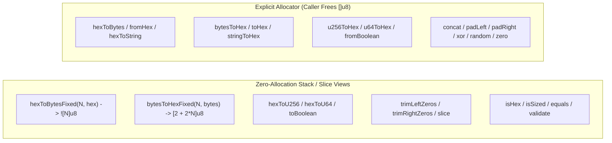

`primitives.Hex` provides `0x`-prefixed hexadecimal validation, bidirectional byte conversion, numeric parsing (`u64`, `u256`), zero-padding, and zero-trimming.

## Memory & Allocator Model



## Format Rules

- Every hex string accepted or produced by `primitives.Hex` starts with lowercase `"0x"`.
- Byte-decoding functions (`hexToBytes`, `hexToBytesFixed`) require an even number of hex digits after `"0x"`.
- `isHex("0x")` returns `false` (requires at least one hex digit); `hexToBytes(allocator, "0x")` returns an empty 0-byte slice.
- `trimLeftZeros` preserves one `0x00` byte for an all-zero non-empty input so zero values remain representable.

## Zero-Allocation API

| Function | Signature | Notes |
| :--- | :--- | :--- |
| `hexToBytesFixed` | `fn (comptime N: usize, hex: []const u8) ![N]u8` | Requires `"0x"` and exact length `2 + 2*N` |
| `bytesToHexFixed` | `fn (comptime N: usize, bytes: [N]u8) [2 + N * 2]u8` | Lowercase `"0x..."` returned by value |
| `isHex` | `fn (input: []const u8) bool` | True iff `"0x"` followed by 1+ `[0-9a-fA-F]` |
| `validate` | `fn (hex: []const u8) ![]const u8` | Returns input slice on success or `HexError` |
| `isSized` | `fn (hex: []const u8, size_bytes: usize) bool` | Checks valid hex of exact byte count |
| `assertSize` | `fn (hex: []const u8, expected_size: usize) ![]const u8` | Returns input or `HexError.InvalidLength` |
| `hexToU256` | `fn (hex: []const u8) !u256` | Parses `"0x..."` into big-endian `u256` |
| `hexToU64` | `fn (hex: []const u8) !u64` | Parses `"0x..."` into `u64` (`ValueTooLarge` on overflow) |
| `toBoolean` | `fn (hex: []const u8) !bool` | `"0x0"` / `"0x00"` -> `false`; `"0x1"` / `"0x01"` -> `true` |
| `equals` | `fn (hex1: []const u8, hex2: []const u8) bool` | Case-insensitive hex string equality |
| `size` | `fn (bytes: []const u8) usize` | Returns `bytes.len` |
| `slice` | `fn (bytes: []const u8, start: usize, end: usize) []const u8` | Bounds-clamped sub-slice view |
| `trimLeftZeros` / `trim` | `fn (bytes: []const u8) []const u8` | Strips leading `0x00`, keeping 1 byte for all-zero input |
| `trimRightZeros` | `fn (bytes: []const u8) []const u8` | Strips trailing `0x00` |

## Allocating API (Caller Owns Returned `[]u8`)

| Function | Signature | Notes |
| :--- | :--- | :--- |
| `hexToBytes` / `fromHex` | `fn (Allocator, []const u8) ![]u8` | Decodes `"0x..."` to raw bytes |
| `bytesToHex` / `toHex` | `fn (Allocator, []const u8) ![]u8` | Encodes raw bytes to lowercase `"0x..."` |
| `stringToHex` / `hexToString` | `fn (Allocator, []const u8) ![]u8` | UTF-8 text <-> `"0x..."` |
| `u256ToHex` / `u64ToHex` | `fn (Allocator, u256\|u64) ![]u8` | Minimal hex quantity (`0` -> `"0x0"`) |
| `fromBoolean` | `fn (Allocator, bool) ![]u8` | `true` -> `"0x01"`, `false` -> `"0x00"` |
| `padLeft` / `pad` | `fn (Allocator, []const u8, usize) ![]u8` | Left-pads with `0x00` to `target_length` |
| `padRight` | `fn (Allocator, []const u8, usize) ![]u8` | Right-pads with `0x00` to `target_length` |
| `concat` | `fn (Allocator, []const []const u8) ![]u8` | Joins byte slices |
| `xor` | `fn (Allocator, []const u8, []const u8) ![]u8` | Bitwise XOR of two equal-length hex strings |
| `clone` | `fn (Allocator, []const u8) ![]u8` | Allocates copy |
| `zero` / `random` | `fn (Allocator, usize) ![]u8` | Generates `size_bytes` zero or CSPRNG hex string |

## Example

```zig
const std = @import("std");
const primitives = @import("primitives");
const Hex = primitives.Hex;

pub fn main() !void {
    var gpa = std.heap.GeneralPurposeAllocator(.{}){};
    defer _ = gpa.deinit();
    const allocator = gpa.allocator();

    // Zero-allocation fixed-size round-trip (4-byte selector)
    const selector = try Hex.hexToBytesFixed(4, "0xa9059cbb");
    const selector_hex: [10]u8 = Hex.bytesToHexFixed(4, selector);

    // Zero-allocation numeric parse and zero-trimming
    const gas_limit = try Hex.hexToU64("0x5208"); // 21000
    const raw = [_]u8{ 0x00, 0x00, 0xde, 0xad };
    const trimmed = Hex.trimLeftZeros(&raw); // [0xde, 0xad]

    // Allocated variable-length conversion (caller frees)
    const padded = try Hex.padLeft(allocator, trimmed, 32);
    defer allocator.free(padded);

    const padded_hex = try Hex.bytesToHex(allocator, padded);
    defer allocator.free(padded_hex);

    std.debug.print("Selector: {s}, Gas: {d}\n", .{ &selector_hex, gas_limit });
    std.debug.print("Slot:     {s}\n", .{padded_hex});
}
```

## Error Set (`Hex.HexError`)

| Error | Condition |
| :--- | :--- |
| `InvalidHexFormat` | Missing `"0x"` prefix |
| `OddLengthHex` | Odd number of hex digits in `hexToBytes` |
| `InvalidHexLength` | Fixed-length mismatch in `hexToBytesFixed` |
| `InvalidHexCharacter` | Character outside `[0-9a-fA-F]` |
| `ValueTooLarge` | Value exceeds target integer width (`u64` / `u256`) |
| `InvalidLength` | Byte length mismatch in `assertSize` or `xor` |

Source: `packages/voltaire-zig/src/primitives/Hex/Hex.zig`
