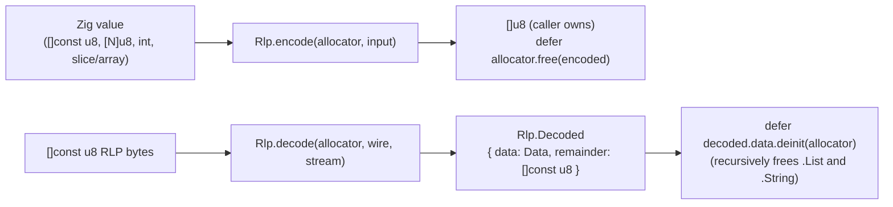

`primitives.Rlp` implements Ethereum's Recursive Length Prefix (RLP) binary serialization per Yellow Paper Appendix B. RLP serializes arbitrarily nested trees of byte strings (`Data.String` and `Data.List`) with a single canonical representation per value.

## Wire Prefix Rules

| First Byte | Type | Payload Length | Layout |
| :--- | :--- | :--- | :--- |
| `0x00..0x7f` | Single byte | 1 byte | Byte itself (`[b]`) |
| `0x80..0xb7` | Short string | `0..55` bytes | `[0x80 + len, payload...]` (`0x80` = empty string / integer `0`) |
| `0xb8..0xbf` | Long string | `> 55` bytes | `[0xb7 + len_of_len, len_be..., payload...]` |
| `0xc0..0xf7` | Short list | `0..55` payload bytes | `[0xc0 + len, encoded_items...]` (`0xc0` = empty list) |
| `0xf8..0xff` | Long list | `> 55` payload bytes | `[0xf7 + len_of_len, len_be..., encoded_items...]` |

## Allocator & Ownership Flow



Every `.String` slice inside `Rlp.Data` is heap-allocated during `decode`. Calling `decoded.data.deinit(allocator)` walks nested `.List` nodes and frees every string and list buffer. `decoded.remainder` is a zero-copy sub-slice pointing into the original `input` buffer.

## Core Types & Constants

```zig
pub const MAX_RLP_DEPTH: u32 = 32;

pub const Data = union(enum) {
    List: []Data,
    String: []const u8,

    pub fn deinit(self: Data, allocator: std.mem.Allocator) void;
};

pub const Decoded = struct {
    data: Data,
    remainder: []const u8,
};
```

## API Reference

| Function | Signature | Allocates | Notes |
| :--- | :--- | :--- | :--- |
| `encode` | `fn (Allocator, anytype) EncodeError![]u8` | Yes | Generic comptime dispatch for `[]const u8`, `[N]u8`, string literals, integers (`0` -> `0x80`), slices/arrays of encodable items |
| `encodeBytes` | `fn (Allocator, []const u8) ![]u8` | Yes | Encodes raw byte slice as an RLP string |
| `encodeList` | `fn (Allocator, anytype) EncodeError![]u8` | Yes | Encodes slice/array as an RLP list |
| `encodeLength` | `fn (Allocator, usize) ![]u8` | Yes | Minimal big-endian length bytes (no leading zeros) |
| `decode` | `fn (Allocator, []const u8, stream: bool) !Decoded` | Yes | When `stream == false`, trailing bytes fail with `RlpError.InvalidRemainder` |
| `isCanonical` | `fn ([]const u8) bool` | No | Checks minimal encoding without full tree allocation |
| `validate` | `fn (Allocator, []const u8) bool` | Temporary | Full decode + canonical check |
| `getEncodedLength` | `fn (Allocator, anytype) !usize` | Temporary | Byte length of RLP-encoded input |
| `getLength` | `fn (Data) usize` | No | Byte length (`.String`) or element count (`.List`) |
| `flatten` | `fn (Allocator, Data) ![]Data` | Yes | Flattens nested `.List` tree into a slice of `.String` leaves |
| `equals` | `fn (Data, Data) bool` | No | Deep structural equality |
| `isList` / `isString` | `fn (Data) bool` | No | Active union tag checks |

## Example

```zig
const std = @import("std");
const primitives = @import("primitives");
const Rlp = primitives.Rlp;

pub fn main() !void {
    var gpa = std.heap.GeneralPurposeAllocator(.{}){};
    defer _ = gpa.deinit();
    const allocator = gpa.allocator();

    // Encode a list of byte strings: ["cat", "dog"] -> 0xc88363617483646f67
    const items = [_][]const u8{ "cat", "dog" };
    const encoded = try Rlp.encode(allocator, items[0..]);
    defer allocator.free(encoded);

    // Strict decode (stream = false rejects trailing bytes)
    const decoded = try Rlp.decode(allocator, encoded, false);
    defer decoded.data.deinit(allocator);

    switch (decoded.data) {
        .List => |list| {
            std.debug.assert(list.len == 2);
            std.debug.print("[0]={s}, [1]={s}\n", .{ list[0].String, list[1].String });
        },
        .String => unreachable,
    }

    // Stream decode concatenated RLP items
    const a = try Rlp.encode(allocator, @as(u64, 0)); // [0x80]
    defer allocator.free(a);
    const b = try Rlp.encode(allocator, @as(u64, 1024)); // [0x82, 0x04, 0x00]
    defer allocator.free(b);

    const stream_buf = try Rlp.concatBytes(allocator, &[_][]const u8{ a, b });
    defer allocator.free(stream_buf);

    var cursor: []const u8 = stream_buf;
    while (cursor.len > 0) {
        const next = try Rlp.decode(allocator, cursor, true);
        defer next.data.deinit(allocator);
        std.debug.print("Item bytes: {d}\n", .{next.data.String.len});
        cursor = next.remainder;
    }
}
```

## Error Set (`Rlp.RlpError`)

| Error | Cause |
| :--- | :--- |
| `InputTooShort` | Truncated header, length field, or payload |
| `InputTooLong` | Payload exceeds input bounds |
| `LeadingZeros` | Multi-byte length starts with `0x00` |
| `NonCanonicalSize` | Single byte `< 0x80` encoded with `0x81` prefix, or length `< 56` encoded in long form |
| `InvalidLength` | Malformed length prefix |
| `UnexpectedInput` | Invalid byte sequence |
| `InvalidRemainder` | Trailing bytes present when `stream == false` |
| `ExtraZeros` | Non-minimal zero padding |
| `RecursionDepthExceeded` | Nested list depth exceeds `MAX_RLP_DEPTH` (32) |

Source: `packages/voltaire-zig/src/primitives/Rlp/Rlp.zig`
