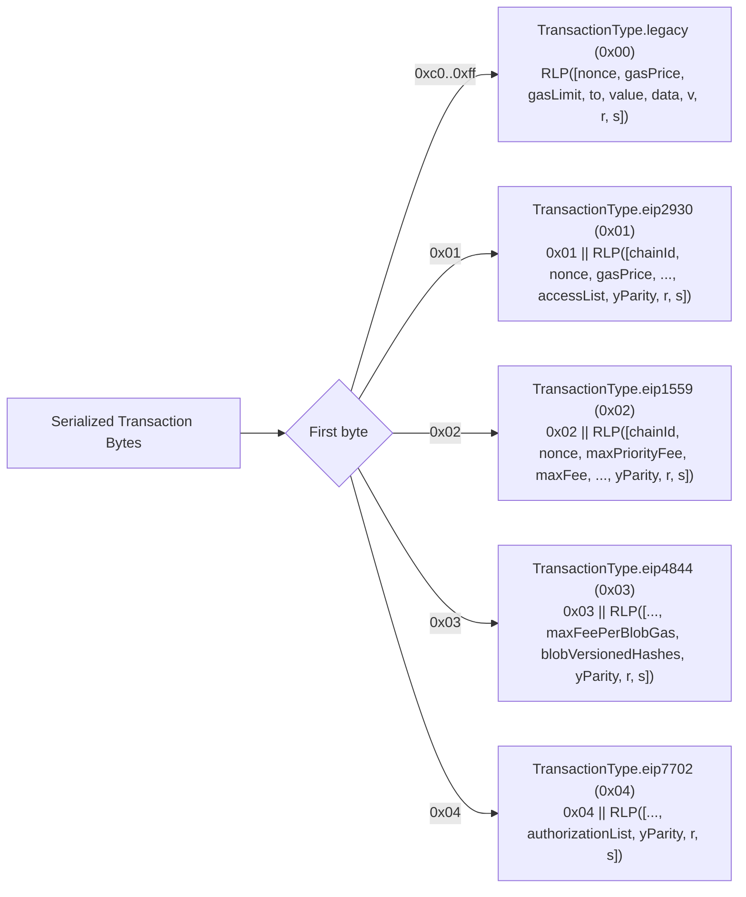

`primitives.Transaction` defines strongly-typed structs and RLP/EIP-2718 encoders for all five Ethereum transaction envelopes: Legacy (`0x00`), EIP-2930 (`0x01`), EIP-1559 (`0x02`), EIP-4844 (`0x03`), and EIP-7702 (`0x04`).

## EIP-2718 Type Dispatch



## Struct Comparison

| Type | Envelope Byte | Fee Fields | `to` Field | Extra Lists | Signature Parity |
| :--- | :--- | :--- | :--- | :--- | :--- |
| `LegacyTransaction` | none (RLP list) | `gas_price: u256` | `?Address` | — | `v: u64` (27/28 or EIP-155) |
| `Eip2930Transaction` | `0x01` | `gas_price: u256` | `?Address` | `access_list` | `y_parity: u8` (`0` or `1`) |
| `Eip1559Transaction` | `0x02` | `max_priority_fee_per_gas`, `max_fee_per_gas` | `?Address` | `access_list` | `y_parity: u8` |
| `Eip4844Transaction` | `0x03` | `max_priority_fee_per_gas`, `max_fee_per_gas`, `max_fee_per_blob_gas` | `Address` (non-null) | `access_list`, `blob_versioned_hashes` | `y_parity: u8` |
| `Eip7702Transaction` | `0x04` | `max_priority_fee_per_gas`, `max_fee_per_gas` | `?Address` | `access_list`, `authorization_list` | `y_parity: u8` |

Every transaction struct holds `r: [32]u8`, `s: [32]u8`, `data: []const u8`, `nonce: u64`, `gas_limit: u64`, and `value: u256`. Contract creation sets `.to = null` (disallowed by protocol on `Eip4844Transaction`, whose `.to` is non-optional `Address`).

## API Reference

### Encoding, Signing & Hashing

| Function | Signature | Allocates | Notes |
| :--- | :--- | :--- | :--- |
| `encodeLegacyForSigning` | `fn (Allocator, LegacyTransaction, chain_id: u64) ![]u8` | Yes (caller frees) | EIP-155 signing preimage |
| `encodeEip2930ForSigning` | `fn (Allocator, Eip2930Transaction) ![]u8` | Yes (caller frees) | `0x01 \|\| RLP(unsigned_fields)` |
| `encodeEip1559ForSigning` | `fn (Allocator, Eip1559Transaction) ![]u8` | Yes (caller frees) | `0x02 \|\| RLP(unsigned_fields)` |
| `encodeEip4844ForSigning` | `fn (Allocator, Eip4844Transaction) ![]u8` | Yes (caller frees) | `0x03 \|\| RLP(unsigned_fields)` |
| `encodeEip7702ForSigning` | `fn (Allocator, Eip7702Transaction) ![]u8` | Yes (caller frees) | `0x04 \|\| RLP(unsigned_fields)` |
| `encodeAccessList` | `fn (Allocator, []const AccessListItem) ![]u8` | Yes (caller frees) | RLP-encodes EIP-2930 access list |
| `signLegacyTransaction` | `fn (Allocator, LegacyTransaction, Crypto.PrivateKey, chain_id: u64) !LegacyTransaction` | Temporary | Signs with EIP-155 `v = chain_id * 2 + 35 + recovery_id` |
| `computeLegacyTransactionHash` | `fn (Allocator, LegacyTransaction) !Hash` | Temporary | `keccak256(RLP(signed_tx))` |
| `computeEip1559TransactionHash` | `fn (Allocator, Eip1559Transaction) !Hash` | Temporary | `keccak256(0x02 \|\| RLP(signed_tx))` |
| `computeEip4844TransactionHash` | `fn (Allocator, Eip4844Transaction) !Hash` | Temporary | `keccak256(0x03 \|\| RLP(signed_tx))` |
| `computeEip7702TransactionHash` | `fn (Allocator, Eip7702Transaction) !Hash` | Temporary | `keccak256(0x04 \|\| RLP(signed_tx))` |

### Inspection (Zero Allocation)

- `detectTransactionType(data: []const u8) TransactionType`
- `isLegacyTransactionSigned` / `isEip1559TransactionSigned` / `isEip4844TransactionSigned` / `isEip7702TransactionSigned`
- `isLegacyTransactionContractCreation` / `isEip1559TransactionContractCreation` / `isEip7702TransactionContractCreation`
- `isLegacyTransactionContractCall` / `isEip1559TransactionContractCall` / `isEip4844TransactionContractCall` / `isEip7702TransactionContractCall`
- `getLegacyTransactionChainId(tx) ?u64` (derives from EIP-155 `v >= 35`, or `null` for pre-EIP-155 `27`/`28`)
- `getEip1559TransactionChainId` / `getEip4844TransactionChainId` / `getEip7702TransactionChainId`
- `getEip4844BlobCount` / `getEip7702AuthorizationCount`

## Example

```zig
const std = @import("std");
const primitives = @import("primitives");
const crypto = @import("crypto");

const Transaction = primitives.Transaction;
const Address = primitives.Address;

pub fn main() !void {
    var gpa = std.heap.GeneralPurposeAllocator(.{}){};
    defer _ = gpa.deinit();
    const allocator = gpa.allocator();

    const recipient = comptime Address.addressFromHex("0x70997970c51812dc3a010c7d01b50e0d17dc79c8");

    const tx = Transaction.Eip1559Transaction{
        .chain_id = 1,
        .nonce = 5,
        .max_priority_fee_per_gas = 2_000_000_000, // 2 gwei
        .max_fee_per_gas = 30_000_000_000,         // 30 gwei
        .gas_limit = 21_000,
        .to = recipient,
        .value = 500_000_000_000_000_000,          // 0.5 ETH
        .data = &[_]u8{},
        .access_list = &[_]Transaction.AccessListItem{},
        .y_parity = 0,
        .r = [_]u8{0} ** 32,
        .s = [_]u8{0} ** 32,
    };

    const signing_payload = try Transaction.encodeEip1559ForSigning(allocator, tx);
    defer allocator.free(signing_payload);

    const tx_type = Transaction.detectTransactionType(signing_payload);
    const signing_hash = primitives.Hash.keccak256(signing_payload);

    std.debug.print("Type:         {s} (prefix 0x{x:0>2})\n", .{ @tagName(tx_type), signing_payload[0] });
    std.debug.print("Signing hash: {s}\n", .{&crypto.Hash.toHex(signing_hash)});
}
```

<Warning>
`signLegacyTransaction` uses `crypto.Crypto.unaudited_signHash` internally. Verify signing flows against audited native signers or hardware wallets before handling mainnet funds.
</Warning>

Source: `packages/voltaire-zig/src/primitives/Transaction/Transaction.zig`
