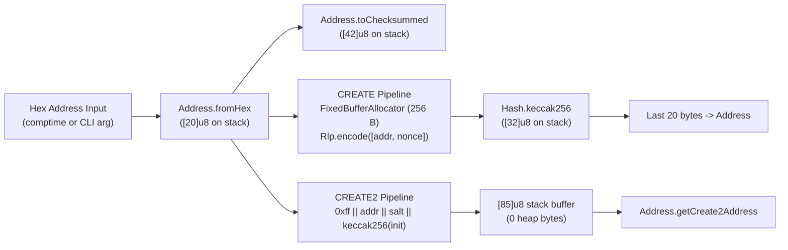

Picture this: it is 11:40 PM before a contract deployment. Your deployment pipeline needs to verify three things offline before anyone signs a transaction on a hardware wallet:

1. Checksum and validate the deployer address.
2. Predict the exact `CREATE` and `CREATE2` contract addresses from the deployer, nonce/salt, and init code.
3. Inspect the RLP bytes and Keccak-256 digest of the `CREATE` preimage so your auditors can independently reproduce the address.

Someone on your team knocked together a quick Zig script—and it has **three subtle bugs** waiting to burn your deployment.

## Spot the Bugs Before Scrolling

Look closely at this naive Zig snippet. Three things are wrong here—two will silently compute the wrong Ethereum address, and one leaks memory on every call:

```zig
const std = @import("std");
const primitives = @import("primitives");

fn brokenPredict(allocator: std.mem.Allocator, deployer_hex: []const u8, nonce: u64) ![42]u8 {
    // Bug 1: runtime parsing of a constant deployer hex with no checksum check
    const deployer = try primitives.Address.fromHex(deployer_hex);

    // Bug 2: RLP-encodes [deployer, nonce], then leaks the buffer
    const encoded = try primitives.Rlp.encode(allocator, [_][]const u8{
        &deployer.bytes,
        std.mem.asBytes(&nonce),
    });

    // Bug 3: hashes with NIST SHA3-256 instead of Ethereum Keccak-256!
    var digest: [32]u8 = undefined;
    std.crypto.hash.sha3.Sha3_256.hash(encoded, &digest, .{});

    const contract = try primitives.Address.fromBytes(digest[12..32]);
    return primitives.Address.toChecksummed(contract);
}
```

<Accordion title="Did you catch all three bugs?">
1. **Heap leak (`encoded` is never freed)**: `Rlp.encode` allocates a `[]u8` on the heap. Without `defer allocator.free(encoded);`, every invocation leaks memory—and `std.testing.allocator` will immediately flag it.
2. **Wrong nonce byte encoding**: `std.mem.asBytes(&nonce)` dumps 8 little-endian bytes (`[0, 0, 0, 0, 0, 0, 0, 0]` for nonce `0`). Ethereum RLP encodes integers in **big-endian with no leading zeros**, and `0` encodes as the empty byte string `0x80`!
3. **NIST SHA3-256 != Keccak-256**: `std.crypto.hash.sha3.Sha3_256` pads with `0x06`, while Ethereum's Keccak-256 pads with `0x01`. The digest is completely different, so you would send funds to a dead address!
</Accordion>

Let's build the right tool from scratch—and make it **zero-heap-allocation** on the hot path by combining Zig's `comptime`, stack arrays, and `std.heap.FixedBufferAllocator`.

## What We Are Building

We will build `eth-inspect`, a small Zig 0.15 CLI and testable library with three pipelines:



Notice the byte layouts behind both deployment opcodes:

### `CREATE` Preimage (RLP-Encoded List)

| Field | RLP Encoding Rule | Example (`nonce = 0`) |
| :--- | :--- | :--- |
| List header | `0xc0 + payload_len` | `0xd6` (`0xc0 + 22`) |
| Deployer (`[20]u8`) | `0x94` (`0x80 + 20`) followed by 20 bytes | `0x94 6ac7ea...dbf0` |
| Nonce (`u64`) | `0x80` if `0`; minimal big-endian bytes otherwise | `0x80` |

### `CREATE2` Preimage (Fixed 85 Bytes, EIP-1014)

| Byte Offset | Size | Field |
| :--- | :--- | :--- |
| `0` | 1 byte | Constant prefix `0xff` |
| `1..21` | 20 bytes | Deployer `Address.bytes` |
| `21..53` | 32 bytes | `salt` (big-endian `[32]u8`) |
| `53..85` | 32 bytes | `keccak256(init_code)` |

`Address.getCreate2Address` builds that 85-byte array directly on the stack—no allocator parameter at all!

<Steps>
  <Step title="Wire up build.zig with Voltaire">
    In your project's `build.zig`, import Voltaire's `primitives` and `crypto` modules:

```zig
const std = @import("std");

pub fn build(b: *std.Build) void {
    const target = b.standardTargetOptions(.{});
    const optimize = b.standardOptimizeOption(.{});

    const voltaire = b.dependency("voltaire", .{
        .target = target,
        .optimize = optimize,
    });

    const root_mod = b.createModule(.{
        .root_source_file = b.path("src/main.zig"),
        .target = target,
        .optimize = optimize,
    });
    root_mod.addImport("primitives", voltaire.module("primitives"));
    root_mod.addImport("crypto", voltaire.module("crypto"));

    const exe = b.addExecutable(.{
        .name = "eth-inspect",
        .root_module = root_mod,
    });
    b.installArtifact(exe);

    const run_cmd = b.addRunArtifact(exe);
    if (b.args) |args| run_cmd.addArgs(args);
    b.step("run", "Run eth-inspect").dependOn(&run_cmd.step);

    const unit_tests = b.addTest(.{ .root_module = root_mod });
    b.step("test", "Run unit tests").dependOn(&b.addRunArtifact(unit_tests).step);
}
```
  </Step>

  <Step title="Lock down static addresses at comptime">
    Whenever a factory address or known constant is hardcoded in your binary, parse it with `Address.addressFromHex` inside `comptime`. If someone drops a hex character or mistypes a byte, **the build fails instead of your production deployment**.

```zig
const std = @import("std");
const primitives = @import("primitives");
const crypto = @import("crypto");

const Address = primitives.Address;
const Hash = primitives.Hash;
const Hex = primitives.Hex;
const Rlp = primitives.Rlp;

// Validated at compile time: zero runtime parsing cost, impossible to ship a bad literal.
const DEFAULT_DEPLOYER = comptime Address.addressFromHex(
    "0x6ac7ea33f8831ea9dcc53393aaa88b25a785dbf0",
);
```

    <Note>
      Watch the subtle difference between `Address.fromHex` and `Address.addressFromHex`:
      - `Address.fromHex(slice)` parses at runtime and returns `!Address` (accepts 40 or 42 chars).
      - `Address.addressFromHex(comptime [42]u8)` runs at compile time, requires the `0x` prefix, and calls `@compileError` on invalid input.
    </Note>
  </Step>

  <Step title="Predict CREATE with a stack-backed FixedBufferAllocator">
    `Address.calculateCreateAddress` needs an allocator only for the tiny RLP buffer (at most 32 bytes for a 20-byte address and a `u64` nonce). Instead of hitting the OS heap, hand it a 256-byte stack buffer via `std.heap.FixedBufferAllocator`:

```zig
pub const CreateReport = struct {
    contract: Address,
    rlp_bytes: [32]u8,
    rlp_len: usize,
    preimage_hash: Hash.Hash,
};

pub fn inspectCreate(deployer: Address, nonce: u64) !CreateReport {
    // 256 bytes on the stack is plenty for RLP([address, nonce]) + intermediate list
    var stack_buf: [256]u8 = undefined;
    var fba = std.heap.FixedBufferAllocator.init(&stack_buf);
    const alloc = fba.allocator();

    // Canonical minimal big-endian encoding for nonce (0 -> empty slice -> 0x80 in RLP)
    var nonce_be: [8]u8 = undefined;
    std.mem.writeInt(u64, &nonce_be, nonce, .big);
    var first_nonzero: usize = 0;
    while (first_nonzero < nonce_be.len and nonce_be[first_nonzero] == 0) : (first_nonzero += 1) {}
    const nonce_slice: []const u8 = if (nonce == 0) &[_]u8{} else nonce_be[first_nonzero..];

    const fields = [_][]const u8{ &deployer.bytes, nonce_slice };
    const encoded = try Rlp.encode(alloc, fields[0..]);
    defer alloc.free(encoded);

    const digest = Hash.keccak256(encoded);
    const contract = try Address.fromBytes(digest[12..32]);

    var out = CreateReport{
        .contract = contract,
        .rlp_bytes = [_]u8{0} ** 32,
        .rlp_len = encoded.len,
        .preimage_hash = digest,
    };
    @memcpy(out.rlp_bytes[0..encoded.len], encoded);
    return out;
}
```

    Look at what just happened:
    - We used `Rlp.encode`, which requires an allocator, **without making a single `malloc` or `mmap` syscall**.
    - We still wrote `defer alloc.free(encoded);` so the function stays leak-free even if you swap `fba.allocator()` for a general-purpose allocator later.
    - Every output field (`contract`, `rlp_bytes`, `preimage_hash`) returns by value on the stack.
  </Step>

  <Step title="Predict CREATE2 with zero allocator at all">
    Now add the `CREATE2` helper. Because `Hash.keccak256` and `Address.getCreate2Address` operate purely on fixed arrays, no allocator appears anywhere in the signature:

```zig
pub fn inspectCreate2(deployer: Address, salt_hex: []const u8, init_code: []const u8) !struct {
    init_code_hash: Hash.Hash,
    contract: Address,
} {
    const salt = try Hex.hexToBytesFixed(32, salt_hex);
    const init_code_hash = Hash.keccak256(init_code);
    const contract = Address.getCreate2Address(deployer, salt, init_code_hash);
    return .{
        .init_code_hash = init_code_hash,
        .contract = contract,
    };
}
```

    <Warning>
      `Hex.hexToBytesFixed(32, salt_hex)` requires the `0x` prefix and exact length (`66` characters for 32 bytes). It returns `HexError.InvalidHexFormat`, `HexError.InvalidHexLength`, or `HexError.InvalidHexCharacter` on bad input.
    </Warning>
  </Step>

  <Step title="Wire up the CLI entry point and verify the output">
    Put everything together in `src/main.zig` with a clean `main()` that handles runtime CLI arguments (or falls back to our comptime deployer):

```zig
pub fn main() !void {
    // Only allocate if reading OS argv
    var gpa = std.heap.GeneralPurposeAllocator(.{}){};
    defer std.debug.assert(gpa.deinit() == .ok);
    const allocator = gpa.allocator();

    const args = try std.process.argsAlloc(allocator);
    defer std.process.argsFree(allocator, args);

    const deployer = if (args.len > 1)
        try Address.fromHex(args[1])
    else
        DEFAULT_DEPLOYER;

    const nonce: u64 = if (args.len > 2)
        try std.fmt.parseInt(u64, args[2], 10)
    else
        0;

    // 1. Checksummed deployer
    const deployer_checksum = Address.toChecksummed(deployer);
    std.debug.print("Deployer:       {s}\n", .{&deployer_checksum});

    // 2. CREATE prediction + RLP inspection (zero heap allocation)
    const create_report = try inspectCreate(deployer, nonce);
    const create_checksum = Address.toChecksummed(create_report.contract);
    const digest_hex = crypto.Hash.toHex(create_report.preimage_hash);

    std.debug.print("CREATE nonce:   {d}\n", .{nonce});
    std.debug.print("RLP ({d} bytes):  0x", .{create_report.rlp_len});
    for (create_report.rlp_bytes[0..create_report.rlp_len]) |b| {
        std.debug.print("{x:0>2}", .{b});
    }
    std.debug.print("\n", .{});
    std.debug.print("Keccak-256:     {s}\n", .{&digest_hex});
    std.debug.print("CREATE address: {s}\n\n", .{&create_checksum});

    // 3. CREATE2 prediction (EIP-1014 zero-allocation path)
    const salt_hex = "0x0000000000000000000000000000000000000000000000000000000000000000";
    const init_code = [_]u8{0x00};
    const c2 = try inspectCreate2(Address.zero(), salt_hex, &init_code);
    const c2_checksum = Address.toChecksummed(c2.contract);
    const init_hash_hex = crypto.Hash.toHex(c2.init_code_hash);

    std.debug.print("CREATE2 init hash: {s}\n", .{&init_hash_hex});
    std.debug.print("CREATE2 address:   {s}\n", .{&c2_checksum});
}
```

    Run it with `zig build run`:

```bash
zig build run
```

    Checkpoint — verify your output matches these exact bytes:

```text
Deployer:       0x6ac7ea33f8831ea9dcc53393aaa88b25a785dbf0
CREATE nonce:   0
RLP (23 bytes): 0xd6946ac7ea33f8831ea9dcc53393aaa88b25a785dbf080
Keccak-256:     0x...cd234a471b72ba2f1ccf0a70fcaba648a5eecd8d
CREATE address: 0xCD234A471B72ba2F1CCF0a70FCaba648A5EECD8d

CREATE2 init hash: 0xbc36789e7a1e281436464229828f817d6612f7b477d66591ff96a9e064bcc98a
CREATE2 address:   0x4D1A2e2bB4F88F0250f26Ffff098B0b30B26BF38
```

    Notice the final 20 bytes of `Keccak-256` match the `CREATE` address (`cd234a471b72ba2f1ccf0a70fcaba648a5eecd8d`)—that is the canonical Ethereum Yellow Paper vector for deployer `0x6ac7ea...` at nonce `0`.
  </Step>

  <Step title="Prove leak freedom and spec compliance with unit tests">
    Add tests at the bottom of `src/main.zig` using `std.testing.allocator`, which automatically fails the test if a single byte leaks:

```zig
test "CREATE matches Address.calculateCreateAddress and leaks nothing" {
    const allocator = std.testing.allocator;

    const report = try inspectCreate(DEFAULT_DEPLOYER, 0);
    const expected = try Address.calculateCreateAddress(allocator, DEFAULT_DEPLOYER, 0);

    try std.testing.expectEqual(expected, report.contract);
    try std.testing.expectEqual(@as(usize, 23), report.rlp_len);
    try std.testing.expectEqual(@as(u8, 0xd6), report.rlp_bytes[0]);
    try std.testing.expectEqual(@as(u8, 0x80), report.rlp_bytes[22]);
}

test "CREATE2 matches EIP-1014 vector" {
    const salt = "0x0000000000000000000000000000000000000000000000000000000000000000";
    const init_code = [_]u8{0x00};
    const res = try inspectCreate2(Address.zero(), salt, &init_code);
    const expected = comptime Address.addressFromHex("0x4d1a2e2bb4f88f0250f26ffff098b0b30b26bf38");
    try std.testing.expectEqual(expected, res.contract);
}
```

    Run `zig build test` — both tests should pass with zero leaks reported.
  </Step>
</Steps>

## Check Your Understanding

<Accordion title="Why did inspectCreate need 256 bytes of stack buffer if the RLP output is only 23 bytes?">
  Inside `Rlp.encode`, Voltaire encodes each element of the input slice first (allocating small temporary slices for the 20-byte address and the nonce), builds the list header and concatenated payload in an unmanaged `std.ArrayList(u8)`, and converts it with `toOwnedSlice`. Those temporary allocations all live briefly inside `FixedBufferAllocator` before being freed, and `FixedBufferAllocator` bumps forward until freed in LIFO order. Giving it 256 bytes guarantees headroom for any `u64` nonce without hitting `error.OutOfMemory`.
</Accordion>

<Accordion title="What happens if you pass a 42-byte string without 0x to Address.fromHex vs Address.addressFromHex?">
  - `Address.fromHex` accepts **either** 40 hex chars (no `0x`) **or** 42 chars (with `0x`/`0X`). A 42-character string without `0x` returns `error.InvalidHexFormat`.
  - `Address.addressFromHex` takes `comptime hex: [42]u8` and enforces `0x` at compile time via `@compileError`.
</Accordion>

<Accordion title="Why can't you replace Hash.keccak256 with std.crypto.hash.sha3.Sha3_256?">
  Ethereum finalized its Yellow Paper specification before NIST changed the domain-separation padding byte in FIPS 202 (SHA-3). Keccak-256 uses padding byte `0x01`; NIST SHA3-256 uses `0x06`. Always use `primitives.Hash.keccak256`, `crypto.Hash.keccak256`, or `crypto.Keccak256` (`std.crypto.hash.sha3.Keccak256`).
</Accordion>

## What You Built

You wrote a leak-checked, zero-heap-allocation Ethereum inspection tool in Zig 0.15 that:
- Validates hardcoded hex addresses at compile time (`Address.addressFromHex`).
- Computes EIP-55 checksums and Keccak-256 digests directly on the stack (`Address.toChecksummed`, `Hash.keccak256`).
- Uses `FixedBufferAllocator` to run heap-parameterized `Rlp.encode` inside a 256-byte stack frame.
- Verifies both `CREATE` and `CREATE2` predictions against canonical Ethereum test vectors.

## Next Steps

- [Address Reference](/primitives/address) — Every constructor, comparison, and ABI encoding helper on `primitives.Address`.
- [RLP Reference](/primitives/rlp) — Streaming decode, recursion depth limits, and canonical validation.
- [Keccak-256 Reference](/crypto/keccak256) — Stdlib, SIMD-accelerated (`Keccak256_Accel`), and assembly (`keccak_asm`) backends.
- [Zig 0.15 Patterns](/dev/zig-patterns) — Allocator conventions, `errdefer` rules, and unmanaged `ArrayList` idioms used throughout Voltaire.
